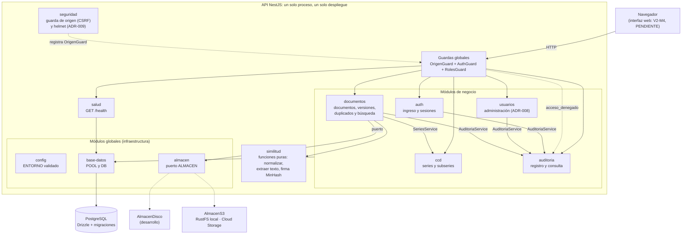

# Arquitectura: diagrama de componentes

- **Fecha:** 22 de noviembre de 2026
- **Issue:** #22 (1.3.3 del plan de mejora)
- **Qué es:** el diagrama de componentes de la API **como está construida hoy**, comparado con lo que decidió el [ADR-002](adr/0002-arquitectura-modular.md) (monolito modular con puertos y adaptadores). Las diferencias se dicen en la sección 4; el ADR no se modifica aquí porque es una decisión aceptada.
- **Etiquetas de certeza:** [CONFIRMADO] comprobado leyendo el código del repositorio el 22 de noviembre; [PROPUESTA] decidido pero no construido; [POR VERIFICAR] falta un dato o una prueba.

## 1. Componentes y dependencias [CONFIRMADO]

**Cómo leerlo.** Línea continua: un módulo usa a otro (por su servicio, salvo lo anotado en la sección 4). Línea punteada: elección en tiempo de ejecución (qué adaptador de archivos se usa lo decide `ALMACEN_TIPO`; las guardas escriben `acceso_denegado` en la auditoría). Los módulos globales (`config`, `base-datos`, `almacen`) los puede inyectar cualquier módulo sin importarlos; por eso no se dibuja una flecha desde cada uno.

## 2. Qué hay detrás de cada caja

| Componente | Responsabilidad | Pieza principal |
|---|---|---|
| Guardas globales | Otro origen en una petición que modifica → 403 (`OrigenGuard`, módulo `seguridad`); sin sesión → 401; rol insuficiente → 403 y evento de auditoría. La regla por endpoint está en [`docs/matriz-de-roles.md`](matriz-de-roles.md), verificada por una prueba | `auth/auth.guard.ts`, `auth/roles.guard.ts` |
| `auth` | Ingreso, cierre de sesión, sesiones en PostgreSQL con cookie `HttpOnly` (ADR-003), `argon2id`, y el límite de intentos de ingreso por usuario e IP (ADR-009) | `auth.service.ts`, `sesiones.repository.ts` |
| `usuarios` | Crear, listar, cambiar rol y desactivar; protege al último administrador (ADR-008) | `usuarios.service.ts` |
| `ccd` | Cuadro de clasificación provisional: árbol de series y subseries. Se carga fuera de la API con `npm run ccd:importar` (CSV) | `series.service.ts`, `importar/` |
| `documentos` | Cargar, versionar, restaurar, descargar, verificar duplicados (ADR-006) y buscar (ADR-007) | `documentos.service.ts`, `versiones.service.ts`, `duplicados.service.ts` |
| `auditoria` | Eventos inmutables (disparador en la base) y su consulta, solo para el administrador | `auditoria.service.ts` |
| `similitud` | Normalización de texto, extracción de texto de PDF y firmas MinHash. Sin dependencias de Nest ni de la base | `similitud/*.ts` |
| `almacen` | Puerto `AlmacenArchivos` (guardar, leer, borrar) y sus dos adaptadores (ADR-004) | `almacen-disco.ts`, `almacen-s3.ts` |
| `seguridad` | Guarda global de origen contra CSRF y `configurarSeguridad` (helmet y proxies de confianza), que usan `main.ts` y las pruebas (ADR-009) | `origen.guard.ts`, `configurar.ts` |
| `config`, `base-datos` | Variables de entorno validadas al arrancar; conexión, esquema y migraciones | `entorno.ts`, `esquema.ts` |

Fuera de la API, con la misma imagen (ver [`docs/despliegue.md`](despliegue.md)): `migrar-cli` (migrar), `crear-administrador` (primer administrador), `sembrar` (datos de demostración, solo desarrollo), `limpiar-huerfanos` (archivos sin versión) e `importar-cli` (carga el cuadro de clasificación desde un CSV, `ccd/importar/`; **no es un endpoint a propósito**, [ADR-010](adr/0010-importacion-del-cuadro-por-comando.md)). Los dos primeros no dependen de la API; todos usan el esquema directamente porque corren fuera de Nest. `importar-cli` y sus piezas (lector de CSV, validación, plan y escritura en una transacción) viven en la carpeta del módulo `ccd` pero no forman parte de su módulo de Nest: no pasan por las guardas ni por la matriz de roles.

## 3. Capas dentro de un módulo (ADR-002) [CONFIRMADO]

`controller` → `service` → `repository`. El controller valida y traduce HTTP; el service tiene las reglas; el repository es el único que usa Drizzle. Se cumple en `documentos`, `ccd`, `auditoria`, `auth` y `usuarios`.

## 4. Diferencias con el ADR-002 [CONFIRMADO]

El ADR-002 dice que las reglas de dependencia «se aplican por convención y revisión del PR; hoy ninguna herramienta las verifica». Al dibujar el diagrama se revisaron las importaciones reales y se encontró esto:

| # | Regla o dato del ADR-002 | Lo que hay hoy | Gravedad |
|---|---|---|---|
| 1 | Regla 1: un módulo usa a otro **solo por sus servicios**, nunca por sus tablas | Tres repositorios hacen **joins directos con tablas de otros módulos**: `documentos.repository.ts` con `series_ccd` y `usuarios` (listado con código de serie y nombre del autor); `auditoria.repository.ts` con `usuarios` (nombre del autor del evento); `usuarios-admin.repository.ts` con `usuarios` y `sesiones` (las tablas que `auth` también usa) | Baja: son lecturas para armar un listado en una sola consulta, y la alternativa (pedir cada dato por servicio) cuesta una consulta más por fila o un cálculo en memoria. Pero **no es lo que el ADR dice** |
| 2 | Regla 1: no se importan repositorios ajenos | `documentos.module.ts` **exporta** `DocumentosRepository` y `almacen/limpiar-huerfanos.ts` lo importa (lo construye a mano, fuera de Nest) | Baja: es un script de mantenimiento. [POR VERIFICAR] si el `exports` del módulo sigue haciendo falta; ningún otro módulo lo inyecta |
| 3 | Un controller no tiene reglas ni mezcla módulos | `usuarios.controller.ts` importa `IdentificadorPipe` desde `documentos/paginacion.ts` | Mínima: una utilidad de validación de identificadores que vive en el módulo equivocado |
| 4 | Puertos previstos: `AlmacenArchivos` y `Reloj` | **`AlmacenArchivos` existe (ADR-004). `Reloj` nunca se construyó**: el código llama a `new Date()` directamente (`auth.service.ts`, `salud.service.ts`) | Ninguna: el ADR lo marcaba [PROPUESTA]. Conviene tacharlo del ADR |
| 5 | Tabla de módulos: `config`, `base-datos`, `salud`, `auth`, `ccd`, `documentos`, `auditoria` | Además existen **`usuarios`** (#17, ADR-008), **`almacen`** (el módulo del puerto) y **`similitud`** (biblioteca sin módulo de Nest) | Ninguna: crecimiento esperado. El ADR no lista los tres |

[PROPUESTA] Dos salidas posibles, a decidir con el usuario; no se tomaron aquí:

- **(a) Corregir el ADR-002**: aceptar explícitamente que un repositorio puede **leer** (no escribir) tablas de otro módulo en un join de listado, y tachar `Reloj`. Es lo más barato y deja el documento diciendo lo que el código hace.
- **(b) Hacer cumplir la regla con una prueba** (por ejemplo, que solo `auth` escriba en `usuarios` y `sesiones`, y que ningún `*.repository.ts` importe otro `*.repository.ts`). Más trabajo, y habría que decidir qué joins se permiten antes de escribirla.

La **regla que sí importa para la seguridad ya se verifica automáticamente**: quién puede llamar a cada endpoint ([`matriz-de-roles.md`](matriz-de-roles.md)).

## 5. Lo que el diagrama no muestra

- **El despliegue** (Cloud Run, Neon, Cloud Storage): está en [`despliegue.md`](despliegue.md).
- **El modelo de datos** (tablas, índices, disparadores): está en [`modelo-de-datos.md`](modelo-de-datos.md), verificado por una prueba contra la base.
- **La interfaz web** (V2-M4): no existe todavía. Según el plan, la propia API la servirá compilada, en un solo origen.
