# BORRADOR · Manual de usuario de Faro · Gestión documental

> **BORRADOR. No es la versión final.** Lo revisan **César** (parte académica) y **Juan** (parte técnica). [POR VERIFICAR] quién redacta la versión final: este texto es un punto de partida, no un documento aprobado.
>
> - **Estado:** borrador del issue #27, 23 de noviembre de 2026; secciones 10 y 11 actualizadas el 24 y el 25 de noviembre, y puesto al día el 25 de noviembre con todos los PR ya fusionados en `main` (`4cd67ad`). Describe **solo lo que existe en el código** de `main`: el de la interfaz de los PR #54, #58, #62 y #66 y el de la API de las claves del PR #57. Lo que no se pudo confirmar va marcado.
> - **Etiquetas de certeza:** [CONFIRMADO] comprobado con una captura, un PR o un documento del repositorio; [POR VERIFICAR] falta comprobarlo con la pantalla real o con una persona; [SUPUESTO] razonable pero sin medir; [PROPUESTA] sugerencia de uso, no una regla del sistema; [PENDIENTE] falta algo por hacer (por ejemplo, una captura que aún no existe).
> - **Datos de demostración:** todo lo que se ve en las capturas es **ficticio** (usuarios `*.demo`, documentos inventados). El sistema es un prototipo de clase: **no cargues documentos reales de la entidad** hasta que la entidad lo autorice por escrito.
> - **Qué pantallas están listas hoy.** Toda la interfaz está ya en `main` (los cuatro PR se fusionaron el 25 de noviembre de 2026): ingreso, listado y detalle (PR #54); carga, versión nueva, comparación de duplicado y restaurar (PR #58); administración de usuarios y auditoría (PR #62); y cambio y restablecimiento de clave (PR #66, sobre la API del PR #57). Todas las capturas son de datos ficticios. Las de clave (45 a 51) y las rehechas 39 y 43 se tomaron **antes de fusionar**, en una rama local descartable que juntaba esos PR; el código de la interfaz (`apps/web/src`) de `main` es idéntico al de la punta `5a6bffa` del #66 con la que se tomaron [CONFIRMADO: `git diff 5a6bffa origin/main -- apps/web/src` sin diferencias]. Cada sección dice qué captura la respalda.
> - Para quien instala o prueba el sistema, no para quien lo usa: [`README.md`](../README.md).

## 1. Qué es Faro

Faro es un **repositorio central de documentos en PDF** para la E.I.C.E. Faro del Catatumbo S.A.S. Sirve para que quien trabaja en ingeniería, jurídica, contabilidad o gerencia pueda:

- **Encontrar** un documento por su título, su expediente o su contenido, sin pedírselo a otra persona.
- **Saber cuál es la versión vigente** de un documento y ver quién cambió qué, cuándo y por qué.
- **Evitar duplicados:** el sistema avisa si el archivo que subes ya existe o se parece mucho a otro (por ejemplo, un reescaneo).
- **Dejar rastro:** todo lo importante queda registrado, para responder ante un ente de control.

Ejemplos de uso [SUPUESTO: a validar con cada área, no salen de una prueba con usuarios]:

- **Ingeniería:** encontrar el informe de interventoría de una obra y ver cuál es su versión vigente, sin pedirlo al archivo.
- **Jurídica:** ver qué cambió entre dos versiones de un contrato y quién lo cambió, con el motivo.
- **Contabilidad:** localizar un certificado de disponibilidad por su expediente.
- **Gerencia:** consultar un acta de comité y descargarla.

Lo que **no** es: no reemplaza al archivo de la entidad, no trae las tablas de retención definitivas (TRD y TVD) y no digitaliza el archivo histórico. El cuadro de clasificación que usa es **provisional**.

### Palabras que verás

| Palabra | Qué significa |
|---|---|
| **Documento** | Un PDF clasificado con su título, expediente, subserie y fecha. Puede tener varias versiones. |
| **Expediente** | El código del expediente al que pertenece el documento, por ejemplo `EXP-2026-014`. |
| **Serie y subserie** | El **cuadro de clasificación documental**: las series agrupan, las subseries son donde se guardan los documentos. Solo se puede guardar un documento en una subserie. En los datos de demostración hay, por ejemplo, «100.1 · Contratos de obra» y «400.1 · Actas de comité». |
| **Versión** | Cada archivo que se sube de un documento. La más reciente es la **vigente**. Las anteriores siguen en el historial. |
| **Historial** | La lista de versiones de un documento, con autor, fecha, motivo y archivo. **Solo crece:** nada se edita ni se borra. |
| **Huella (SHA-256)** | Un código que identifica el contenido exacto de un archivo. Dos archivos con la misma huella son idénticos byte por byte. |
| **Capa de texto** | El texto que un PDF trae dentro (un PDF escaneado con OCR la tiene; una foto convertida a PDF, no). Sin ella no se puede buscar por el contenido. |

## 2. Cómo ingresar

1. Abre en el navegador la dirección que te dé quien administra el sistema. Termina en `/app/`. En un equipo de pruebas es `http://127.0.0.1:3000/app/`. Si abres la dirección sin `/app/`, el sistema te lleva solo (`GET /` redirige a `/app/`, ADR-0012).
2. Escribe tu **usuario** y tu **clave** y pulsa **Ingresar**. El botón se activa cuando los dos campos tienen algo.
3. Si todo está bien, llegas a la lista de **Documentos**.

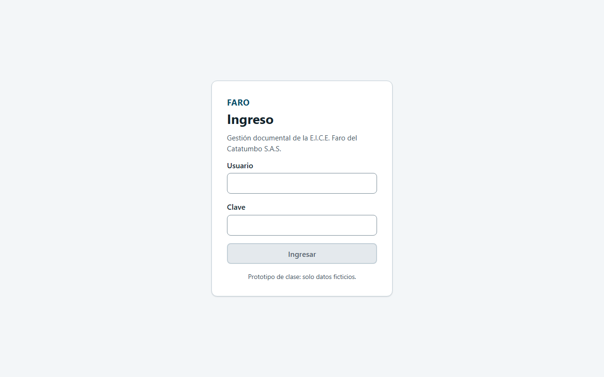

*Captura 1. Ingreso (PR #54, 1280 px). [CONFIRMADO]*

**Si algo falla:**

- «**Usuario o clave incorrectos**»: el mensaje es el mismo si el usuario no existe, está desactivado o la clave está mal, a propósito, para no revelar qué usuarios existen.

  

  *Captura 2. Clave incorrecta. [CONFIRMADO]*

- «**Demasiados intentos de ingreso. Intenta de nuevo en 15 minutos.**»: tras **5 intentos fallidos con el mismo usuario** o **30 desde el mismo lugar** en 15 minutos, el sistema bloquea el ingreso durante ese tiempo (ADR-0009). Espera y vuelve a intentar.

  

  *Captura 3. Bloqueo temporal. [CONFIRMADO]*

- «**Tu sesión terminó. Ingresa de nuevo para continuar.**»: aparece si tu sesión venció. Una sesión vence a las **8 horas sin usarla** y, aunque la uses sin parar, a los **7 días** (ADR-0003). Al ingresar, el sistema intenta llevarte a la pantalla a la que querías ir [POR VERIFICAR] en el caso de una sesión que vence a mitad de uso.

  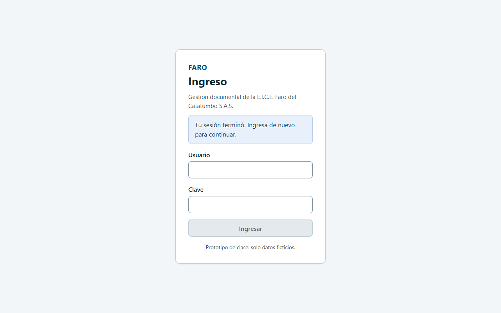

  *Captura 4. Aviso de sesión terminada (PR #62, 1280 px). El aviso se ve entero gracias al arreglo `87ba312`, que llegó a `main` con el PR #62: sin el arreglo, el aviso se partía por renglones y se salía de la tarjeta de ingreso (mensaje del commit). [CONFIRMADO: `87ba312` es ancestro de `main`]*

Para **salir**, pulsa **Cerrar sesión**, arriba a la derecha. Hazlo siempre que uses un computador compartido.

**Tu usuario lo crea el administrador** (ver la sección 10). Mientras se prueba el sistema existen tres usuarios de demostración: `admin.demo`, `editor.demo` y `consulta.demo`; su clave la define quien instala el sistema.

### Si te dieron una clave temporal

Cuando un administrador restablece tu clave, la clave que te da es **temporal** y tendrás que cambiarla (ADR-0011, PR #57). Según la interfaz (PR #66), al ingresar con la clave temporal el sistema te lleva a «Cambiar mi clave» y **no te deja abrir nada más** hasta que elijas una propia (captura 46). Los pasos están en la sección 11 [CONFIRMADO en una rama local descartable que juntaba #66 y #57 antes de fusionar; el código de la interfaz de `main` es el mismo].

## 3. Los tres roles: quién puede hacer qué

Tu **rol** lo ves arriba a la derecha, debajo de tu nombre. El menú de la parte superior cambia según el rol. Fuente: [`docs/matriz-de-roles.md`](matriz-de-roles.md), que una prueba comprueba contra la API real en cada cambio [CONFIRMADO].

| Puedes... | Consulta | Editor | Administrador |
|---|---|---|---|
| Buscar y ver documentos y su historial | Sí | Sí | Sí |
| Descargar el PDF de cualquier versión | Sí | Sí | Sí |
| Cargar un documento nuevo | No | Sí | Sí |
| Subir una versión nueva | No | Sí | Sí |
| Restaurar una versión anterior | No | Sí | Sí |
| Cambiar tu propia clave (API del PR #57, pantalla del PR #66, sección 11) | Sí | Sí | Sí |
| Ver la auditoría (pantalla Auditoría, PR #62, sección 10.2) | No | No | Sí |
| Crear usuarios, cambiar roles, desactivar y reactivar (pantalla Usuarios, PR #62, sección 10.1) | No | No | Sí |
| Restablecer la clave de otra persona (API del PR #57, pantalla del PR #66, sección 11) | No | No | Sí |

**Menú que ves:**

| Rol | Opciones del menú |
|---|---|
| Consulta | Documentos |
| Editor | Documentos, Cargar documento |
| Administrador | Documentos, Cargar documento, Usuarios, Auditoría |

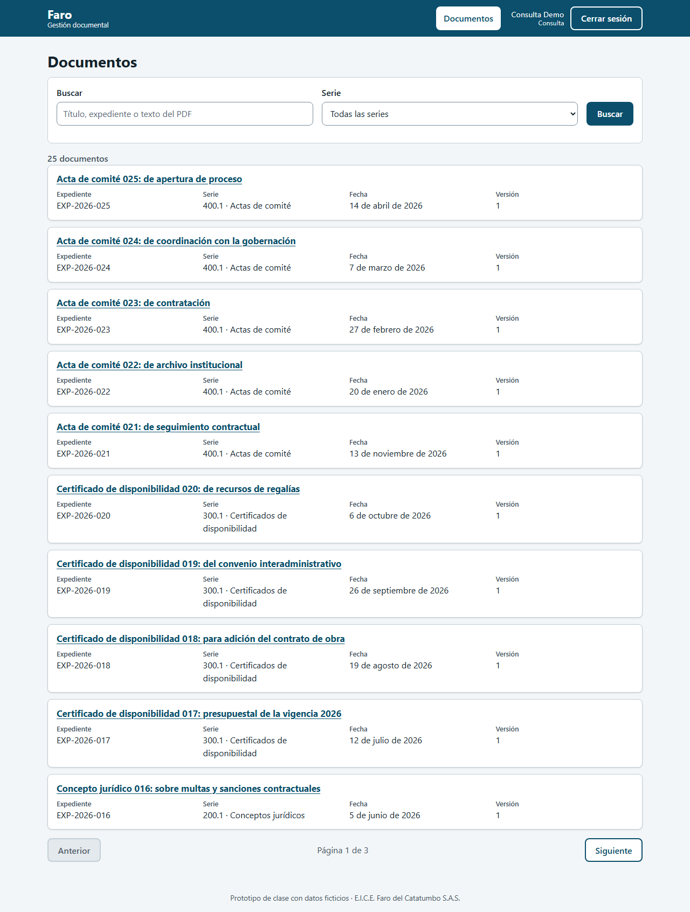

*Captura 5. Rol de consulta: el menú solo tiene «Documentos». [CONFIRMADO]*

Si abres una pantalla que tu rol no admite, verás «**No tienes permiso para ver esta pantalla**. Tu rol no incluye esta función. Si la necesitas, pídesela a quien administra el sistema.»

**Algo que conviene saber [CONFIRMADO]:** hoy **todas las personas con sesión ven todos los documentos**. No hay permisos por expediente, por serie ni por área. Por eso no cargues nada reservado hasta que la entidad decida cómo manejarlo (`docs/matriz-de-roles.md`, sección 4).

## 4. Buscar y filtrar documentos

Al ingresar llegas a **Documentos**. Arriba hay dos controles: **Buscar** y **Serie**.

*Captura 6. Listado de documentos (rol de administrador). Abajo: «Página 1 de 3». [CONFIRMADO]*

**Buscar.** Escribe palabras del título, del expediente o del **texto del PDF** y pulsa **Buscar** (o Enter).

- No importan las **tildes ni las mayúsculas**: «interventoria» encuentra «Interventoría».
- Se encuentran **todas las palabras** que escribas (no basta con una). Más palabras, resultados más precisos.
- Singular y plural se tratan igual, y también las conjugaciones («interventorías», «pagos parciales»).
- Lo que escribas se toma como texto: las comillas, el `&` o el `|` no funcionan como operadores.
- Los resultados salen por **relevancia**: lo que coincide con el título pesa más que lo que coincide con el texto.
- El texto del PDF solo se busca en documentos con **capa de texto**. Si el PDF es una imagen, se encuentra por el título y el expediente, no por su contenido. El detalle de cada versión avisa cuando no la tiene (sección 5).
- Se indexan los primeros 300 000 caracteres de cada documento (unas 100 páginas) [POR VERIFICAR] con PDF reales (ADR-0007).

*Captura 7. Buscar «interventoria» da «6 documentos para «interventoria»». [CONFIRMADO]*

**Filtrar por serie.** El menú **Serie** muestra el cuadro de clasificación. Elige «Toda la serie 100» para ver todos los documentos de esa serie y sus subseries, o una subserie concreta (por ejemplo, «100.2 · Interventoría»). Puedes combinar la búsqueda con la serie.

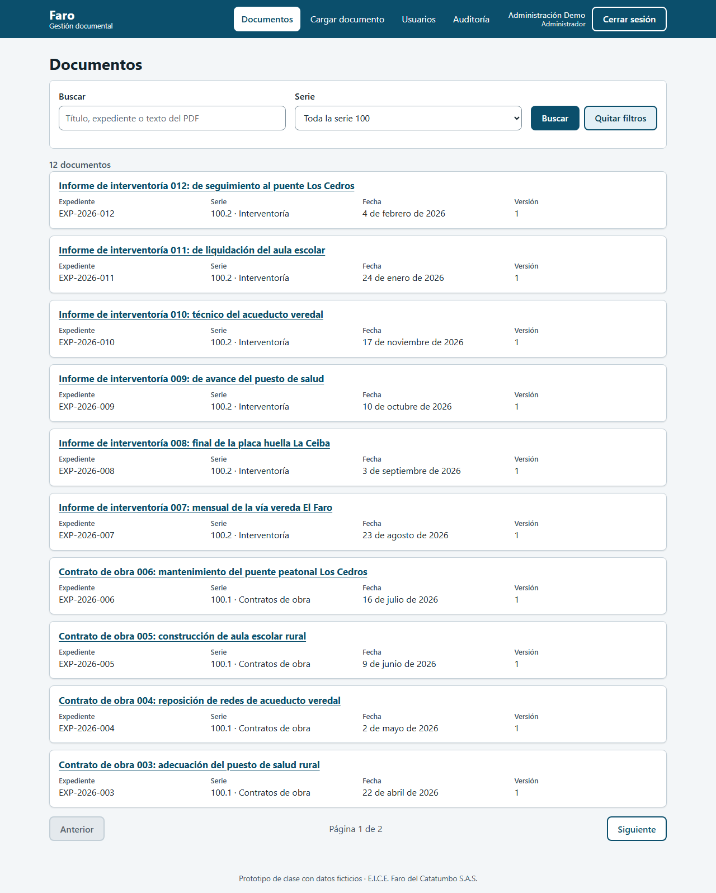

*Captura 8. Filtro «Toda la serie 100»: 12 documentos. [CONFIRMADO]*

**Quitar los filtros.** Pulsa **Quitar filtros** para volver a ver todo.

**Pasar de página.** Se muestran 10 documentos por página: usa **Anterior** y **Siguiente**. Cuando no hay búsqueda, salen primero los cargados más recientemente; según se ve en la captura 6, no se ordenan por la fecha que figura en el documento.

**Compartir lo que ves.** La búsqueda, la serie y la página quedan en la dirección del navegador: puedes copiarla y mandársela a otra persona, o volver atrás sin perder lo que habías buscado.

**Si no aparece nada:** «Ningún documento coincide con lo que buscaste. Prueba con otras palabras o quita los filtros.» Si el sistema está vacío, dice «Aún no hay documentos cargados.» y, a quien puede cargar, le ofrece «Cargar el primer documento».

**En el celular.** La interfaz se adapta desde 360 px de ancho: el menú pasa a varias líneas y los datos de cada documento se acomodan en dos columnas.

*Captura 9. La misma búsqueda en un celular (360 px). [CONFIRMADO]*

## 5. Ver un documento y su historial de versiones

En el listado, pulsa el título de un documento. Verás:

- **Datos del documento:** expediente, serie (con su nombre), fecha del documento, fecha y hora en que se cargó (hora de Colombia) y **versión vigente**.
- **Descargar la versión vigente (PDF)** y, si eres editor o administrador, **Subir una versión nueva**.
- **Historial de versiones**, la más reciente primero. Cada versión muestra:
  - su número, con la etiqueta **Vigente** si es la actual y **Restaura la versión n** si se creó restaurando otra;
  - el **motivo** del cambio;
  - **autor**, **fecha y hora**, **nombre del archivo**, **tamaño** y los primeros caracteres de la **huella SHA-256**;
  - el botón **Descargar** de esa versión;
  - si el PDF no tiene capa de texto: «Sin capa de texto: no se puede buscar por su contenido y solo se verifica por huella exacta.»

*Captura 10. Detalle de «Contrato de obra 001» con cuatro versiones; la 4 es la vigente y restaura la 1. Esta captura es del PR #54: todavía no muestra el botón «Restaurar», que llega con el PR #58 (se ve en las capturas 28 y 32, secciones 8 y 9). [CONFIRMADO]*

**Leer el historial.** «La más reciente primero. El historial solo crece: nada se edita ni se borra.» Si una versión se subió por error, no se borra: se corrige con una versión nueva o restaurando otra, y el error queda en el historial.

**Si el documento no existe** (una dirección mal escrita, por ejemplo), verás «El documento no existe» y un enlace para volver al listado.

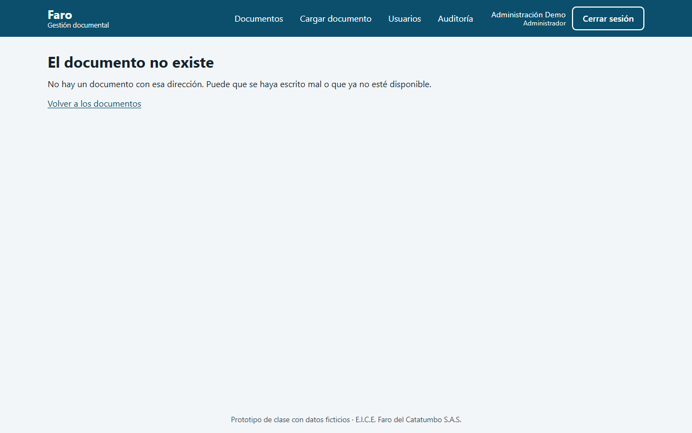

*Captura 11. Documento que no existe. [CONFIRMADO]*

## 6. Descargar un documento

- **Versión vigente:** botón **Descargar la versión vigente (PDF)**, en la parte de arriba del detalle.
- **Cualquier versión:** botón **Descargar** en esa versión del historial.

Todos los roles pueden descargar. **Cada descarga queda registrada en la auditoría** con quién la hizo (README y `docs/matriz-de-roles.md`). Si tu sesión terminó con la página abierta y pulsas descargar, el navegador puede mostrarte un error en vez de llevarte al ingreso: vuelve a ingresar y repite [POR VERIFICAR] qué muestra cada navegador (ADR-0012, sección 4).

## 7. Cargar un documento nuevo

> **Estado:** pantalla del PR #58 (issue #24), fusionada en `main` el 25 de noviembre de 2026. Las capturas de esta sección y de las dos siguientes son de la rama de ese PR antes de fusionarla (commit `a6d6eb1`; las capturas 19 a 21, tomadas tras el arreglo de diseño `cac8cfe`), con datos ficticios [CONFIRMADO]. Lo que no tiene captura va marcado.

**Quién:** editor y administrador. **Dónde:** menú **Cargar documento** (también el enlace «Cargar el primer documento» cuando el sistema no tiene ningún documento).

La pantalla «**Cargar un documento**» explica que, antes de guardar, el sistema revisa si ese mismo archivo, o uno muy parecido (por ejemplo, un reescaneo), ya existe. Pide:

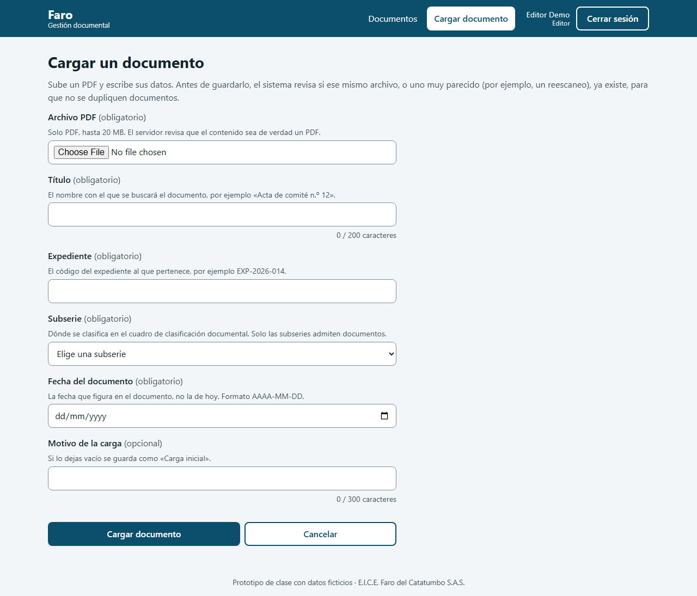

*Captura 12. Formulario de carga, vacío (PR #58, 1280 px). [CONFIRMADO]*

| Campo | Qué escribir | Obligatorio |
|---|---|---|
| **Archivo PDF** | El PDF. Solo PDF, hasta **20 MB**. El servidor revisa que el contenido sea de verdad un PDF (no basta con cambiar la extensión). Al elegirlo, la pantalla muestra «Elegido: nombre · tamaño». | Sí |
| **Título** | El nombre con el que se buscará, por ejemplo «Acta de comité n.º 12». Hasta 200 caracteres (hay un contador). | Sí |
| **Expediente** | El código del expediente, por ejemplo `EXP-2026-014`. Hasta 60 caracteres. | Sí |
| **Subserie** | Dónde se clasifica en el cuadro de clasificación documental. Solo aparecen las subseries, agrupadas por serie. | Sí |
| **Fecha del documento** | La fecha que figura **en el documento**, no la de hoy. Formato AAAA-MM-DD. La interfaz no admite años anteriores a **1900** [PROPUESTA: tope del prototipo para evitar un año mal escrito como `0026`; si la entidad tiene documentos anteriores, se cambia, ADR-0012 sección 6.1]. | Sí |
| **Motivo de la carga** | Opcional. Si lo dejas vacío se guarda como «Carga inicial». Hasta 300 caracteres. | No |

Pulsa **Cargar documento**. Mientras sube, el botón dice «Subiendo el documento…», el formulario queda deshabilitado y no se puede enviar dos veces. Si todo está bien, te lleva al documento con un aviso verde.

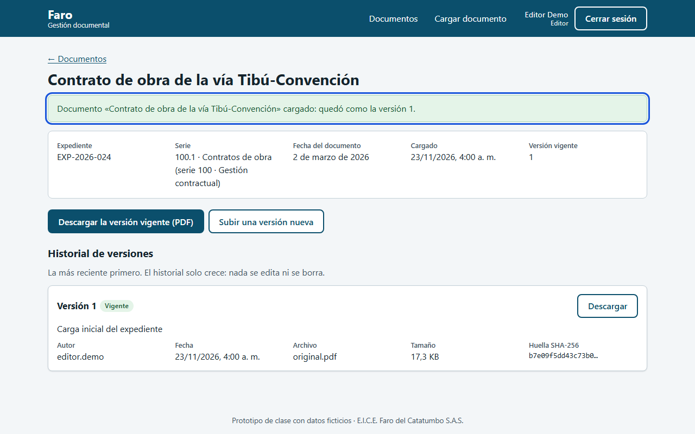

*Captura 13. Carga correcta: «Documento «…» cargado: quedó como la versión 1.» [CONFIRMADO]*

**Cancelar** vuelve al listado.

### Si falta algo o algo está mal

Antes de enviar, el navegador revisa lo que puede. Cada campo con problema se marca en rojo con una frase que dice qué corregir, y el cursor va al primero.

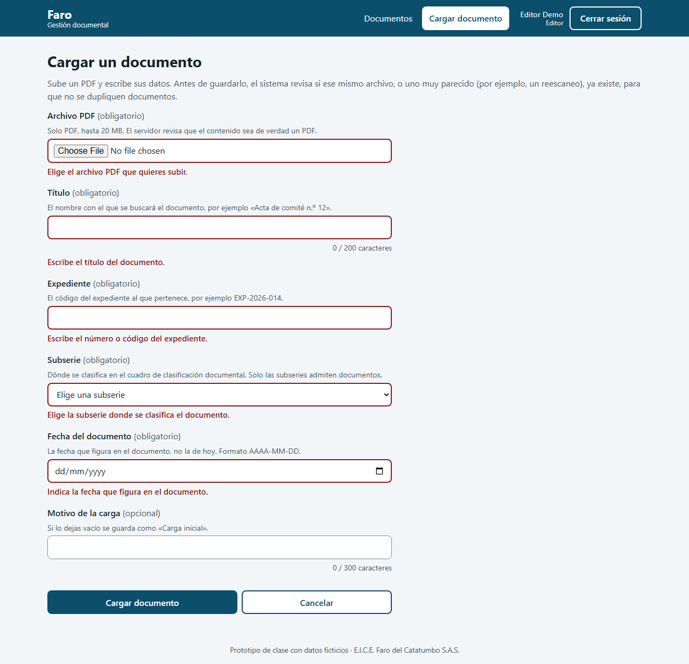

*Captura 14. Se pulsó «Cargar documento» con todo vacío: «Elige el archivo PDF que quieres subir.», «Escribe el título del documento.», «Escribe el número o código del expediente.», «Elige la subserie donde se clasifica el documento.» e «Indica la fecha que figura en el documento.» [CONFIRMADO]*

- **PDF de más de 20 MB.** La pantalla avisa **antes de subir** y no gasta tiempo en enviarlo: «Pasa de 20 MB: este archivo pesa 21,0 MB. Reduce su tamaño o divídelo.» [CONFIRMADO]

  

  *Captura 15. Archivo demasiado grande.*

- **Un archivo que se llama `.pdf` pero no es un PDF.** El navegador no lo puede notar; lo rechaza el servidor y la pantalla lo explica: «El archivo no es un PDF válido. Solo se aceptan archivos PDF: revisa que no sea otro tipo de archivo con la extensión cambiada, o vuelve a guardarlo como PDF.» [CONFIRMADO]

  

  *Captura 16. El servidor rechaza un archivo que no es un PDF.*

Otros mensajes que puedes encontrar **no tienen captura** en este borrador: salen del código de la interfaz (`apps/web/src/api/errores.ts` y `apps/web/src/utilidades/validacion.ts`) [POR VERIFICAR: verlos en pantalla antes de la versión final].

| Si ves... | Qué pasó y qué hacer |
|---|---|
| «El archivo no es un PDF. Solo se aceptan archivos PDF (extensión .pdf).» / «El archivo está vacío. Elige otro.» | El archivo no es PDF o no tiene contenido. Guárdalo como PDF. |
| «El archivo pesa más de 20 MB, que es el máximo. Vuelve a exportarlo con menos calidad de imagen o divídelo en partes.» | El servidor rechazó un archivo muy pesado. |
| «Máximo 200 caracteres: este tiene N.» (con el máximo de ese campo) | El texto es demasiado largo. Acórtalo. |
| «La serie elegida no admite documentos. Elige una subserie del cuadro de clasificación.» | Solo las subseries admiten documentos. |
| «Escribe la fecha como AAAA-MM-DD, por ejemplo 2026-03-15.» / «Esa fecha no existe en el calendario. Revisa el día y el mes.» / «Revisa el año: la fecha no puede ser anterior a 1900.» | La fecha está mal escrita o no existe. |
| «La subserie o el documento elegido ya no existe. Recarga la página para ver el cuadro de clasificación actualizado.» | Alguien cambió el cuadro mientras llenabas el formulario. |
| «No se pudo conectar con el servidor. Revisa tu conexión e intenta de nuevo. Si el archivo llegó a subirse, el sistema te avisará de que ya existe y no se duplicará.» | Sin conexión. Revisa la red y repite. |
| «Tu sesión terminó. Ingresa de nuevo para continuar.» | La sesión venció (sección 2). |
| «Tu usuario no tiene permiso para esta acción. Solo los administradores y los editores pueden cargar documentos y versiones.» | Tu rol es de consulta (ver el final de la sección 9). |
| «Hiciste demasiadas peticiones en poco tiempo. Intenta de nuevo en …» | Límite de peticiones (ADR-0009). Espera. |

### Si el sistema avisa de un duplicado

La **verificación es doble** (ADR-0006): primero compara la huella del archivo con todo lo que ya existe y, si el PDF tiene capa de texto, compara también el **parecido del texto**.

**a) El archivo es idéntico a uno que ya existe.** El sistema **no lo carga** y muestra, debajo del formulario, «**Este archivo ya está en el sistema**»: dice a qué versión de qué documento (título, expediente y subserie) es idéntico, ofrece un enlace para **abrir el documento que ya existe** y recuerda que, si lo que tienes es una corrección, la subas como **versión nueva** de ese documento (sección 8). Lo que escribiste en el formulario se conserva.

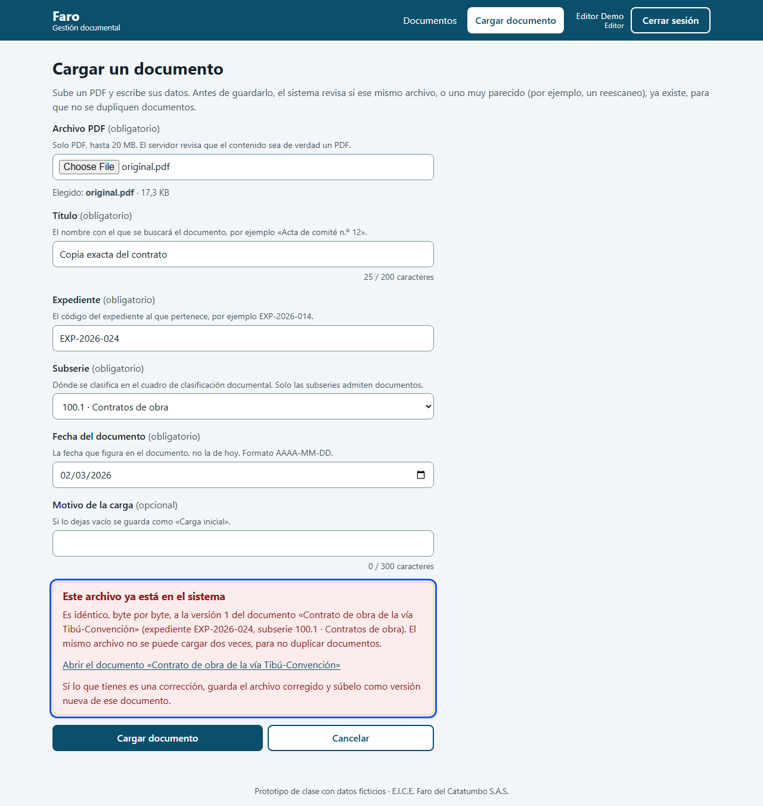

*Captura 17. Archivo idéntico (aviso de duplicado exacto). [CONFIRMADO]*

**b) El archivo se parece mucho a uno que existe (por ejemplo, un reescaneo).** Aparece la pantalla «**Este archivo se parece a un documento que ya existe**», con los dos lados:

*Captura 18. Comparación de un duplicado probable. Los dos documentos son ficticios. [CONFIRMADO]*

- **Ya existe en el sistema:** título, el **porcentaje de parecido en el texto** («95 % de parecido en el texto (el aviso salta desde 80 %)»; el umbral de 80 % es provisional, ADR-0006), expediente, subserie, fecha del documento, versión parecida (por ejemplo «1 (la vigente)» o «1 (la vigente es la 2)»), quién la cargó y cuándo, y los enlaces «Ver el documento (se abre en otra pestaña)» y «Descargar la versión n (PDF)».
- **Lo que intentas cargar** (borde punteado: «Archivo nuevo, todavía sin guardar»): nombre y tamaño del archivo y los datos que escribiste, con el enlace «Abrir el PDF nuevo (se abre en otra pestaña)». En el celular, los dos lados se apilan.

[POR VERIFICAR] **El PDF no se muestra dentro de la página: se abre en otra pestaña.** La política de seguridad de la API no admite incrustarlo (ADR-0012, sección 6.1). Eso significa que no verás los dos documentos lado a lado en la misma pantalla, solo sus datos y el porcentaje; falta confirmar con personas de la entidad si eso basta para decidir (ADR-0012, sección 6.2). La pantalla tampoco muestra **qué texto cambió**, solo cuánto se parecen [PROPUESTA: un visor de diferencias queda fuera del alcance del prototipo].

**Si hay varios documentos parecidos**, el texto de arriba dice cuántos son («…muy parecido al de 2 documentos ya guardados») y, antes de los dos lados, aparece el grupo «**Elige con cuál quieres comparar**». Cada candidato es una **tarjeta propia, una por línea**, con un botón de opción, el título completo entre comillas, el expediente y el porcentaje de parecido (por ejemplo «…· expediente EXP-2026-031 · 95 % de parecido»). Un título largo ocupa dos o más renglones, pero se lee entero. Viene elegido el primero de la lista; al elegir otro cambia el lado «Ya existe en el sistema» (sus datos, su porcentaje y sus enlaces) y la opción «Es una versión nueva de «…»» pasa a nombrar ese documento. El lado «Lo que intentas cargar» no cambia.

*Captura 19. Dos documentos parecidos: la lista de candidatos, cada uno en su tarjeta. [CONFIRMADO]*

*Captura 20. Tres documentos parecidos. [CONFIRMADO]*

*Captura 21. Tres candidatos en el celular (360 px), con el segundo elegido: la tarjeta «Ya existe en el sistema» muestra ese documento. [CONFIRMADO]*

Estas tres capturas se tomaron **después de un arreglo de diseño** del PR #58 (commit `cac8cfe`): antes las tarjetas de la lista se veían encimadas unas sobre otras.

El sistema **solo avisa: decides tú**. Hay tres opciones, y cada una explica en la pantalla qué va a pasar:

| Opción | Qué pasa | Qué te pide |
|---|---|---|
| **Es el mismo documento: no cargar nada** | No se guarda el archivo y no cambia nada: la pantalla no llama a la API. Te lleva al documento que ya existe con el aviso «No se cargó nada: el archivo ya estaba en el sistema como «…».» | Nada. Botón: «No cargar el archivo». |
| **Es una versión nueva de «…»** | Tu archivo se agrega como una versión más del documento que ya existe y pasa a ser la vigente. Las versiones anteriores quedan en el historial. El título, el expediente, la subserie y la fecha que escribiste **no** cambian los del documento existente. | El **motivo** de la versión nueva (obligatorio, hasta 300 caracteres), por ejemplo «Reescaneo con mejor calidad». Botón: «Agregar como versión nueva». |
| **Es otro documento: cargarlo de todos modos** | Se crea un documento nuevo con los datos que escribiste; el que ya existe queda como está. Tu justificación queda registrada en la auditoría. | Una **justificación** (obligatoria, hasta 500 caracteres), por ejemplo «Es el contrato del segundo lote: usa la misma plantilla». Botón: «Cargar como documento nuevo». |

Si pulsas el botón sin elegir, la pantalla dice «Elige qué quieres hacer con este archivo.» Si eliges la segunda o la tercera y dejas vacío el texto, dice «Escribe el motivo: explica qué cambió respecto a la versión que ya existe.» o «Escribe la justificación: explica por qué no es un duplicado.» **Volver y corregir los datos** te devuelve al formulario sin perder lo escrito ni el archivo elegido.

*Captura 22. Resultado de «Es el mismo documento»: no se guardó nada. [CONFIRMADO]*

*Captura 23. «Es una versión nueva»: el motivo es obligatorio. [CONFIRMADO]*

*Captura 24. Resultado de «Es una versión nueva»: el archivo quedó como la versión 2. [CONFIRMADO]*

*Captura 25. «Es otro documento»: la justificación es obligatoria. [CONFIRMADO]*

El resultado de «Es otro documento» es un documento nuevo, con el mismo aspecto que la captura 13 y con el título y el expediente que escribiste. No tiene captura propia en este borrador.

**Cómo decidir** [PROPUESTA, no es una regla del sistema]:

- Si es **el mismo papel escaneado otra vez**, normalmente conviene **no cargar nada** (primera opción) o, si el escaneo nuevo es mejor, **agregarlo como versión nueva**.
- Si es una **actualización o corrección** del mismo documento, **versión nueva**.
- Si es **otro documento que usa la misma plantilla** (actas, contratos y oficios se parecen mucho entre sí), **otro documento**, y escribe bien la justificación.
- Si no estás seguro, abre los dos PDF en otra pestaña y compáralos antes de decidir.

**Tu decisión queda en la auditoría** (acción `decision_duplicado`), con tu justificación o tu motivo. Un PDF sin capa de texto, o con menos de 50 palabras, no se compara por parecido: solo se verifica por huella exacta.

**En el celular.** El formulario se adapta desde 360 px de ancho: los campos ocupan todo el ancho de la pantalla y se leen uno debajo del otro.

*Captura 26. Formulario de carga en celular (360 px). [CONFIRMADO]*

## 8. Subir una versión nueva

**Quién:** editor y administrador. **Dónde:** en el detalle de un documento, botón **Subir una versión nueva** (también se llega a una versión nueva desde la comparación de un duplicado, sección 7). Estado: PR #58 (issue #24), fusionado.

La pantalla muestra el enlace «← título del documento» para volver y recuerda el documento, su expediente y su versión vigente, y avisa: «No se borra nada: la versión actual queda en el historial y la que subas pasa a ser la vigente.» Pide:

*Captura 27. Formulario de versión nueva. [CONFIRMADO]*

- **Archivo PDF** (obligatorio, hasta 20 MB; las mismas reglas que en la carga).
- **Motivo del cambio** (obligatorio, hasta 300 caracteres, con contador): explica qué cambió, por ejemplo «Se corrigió el valor de la cláusula 4». Queda en el historial y es lo que le explica el cambio a un auditor.

Si dejas algo vacío, la pantalla dice «Elige el archivo PDF que quieres subir.» o «Escribe el motivo: explica qué cambió en esta versión.» (misma forma que la captura 14).

Pulsa **Subir versión nueva** (mientras sube dice «Subiendo la versión…»). Te lleva al detalle con el aviso «Se agregó la versión n de «…». Las versiones anteriores siguen en el historial.» y la versión nueva arriba, como vigente.

*Captura 28. Resultado de subir una versión nueva: la versión 3 es la vigente. [CONFIRMADO]*

**Si el archivo ya está en una versión de ese documento**, el sistema lo rechaza y no crea nada: «Este archivo tiene el mismo contenido que la versión n del documento, así que no se creó ninguna versión nueva. Si hiciste cambios, guarda el archivo corregido y súbelo de nuevo.» (ADR-0005).

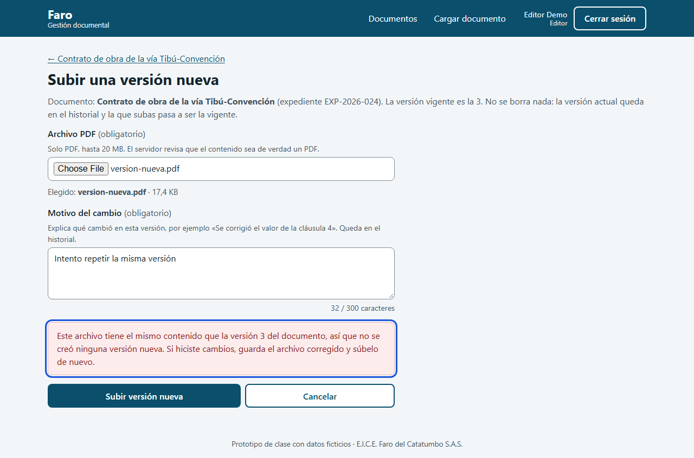

*Captura 29. Se intentó subir el mismo contenido que la versión vigente. [CONFIRMADO]*

Si dos personas suben una versión del mismo documento a la vez, cada una recibe un número distinto y consecutivo; no se pierde ninguna (ADR-0005).

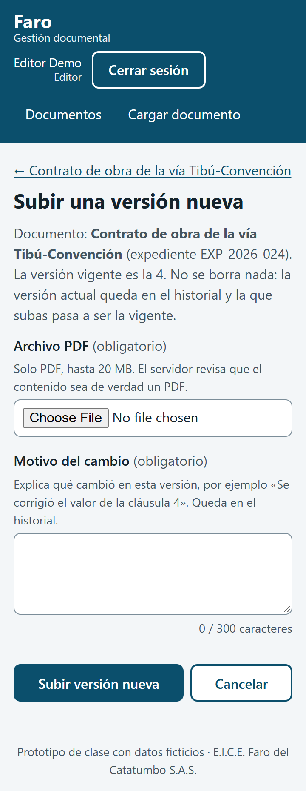

*Captura 30. Versión nueva en celular (360 px). [CONFIRMADO]*

## 9. Restaurar una versión anterior

**Quién:** editor y administrador. **Dónde:** en el historial del detalle, botón **Restaurar** de cada versión que no sea la vigente. Estado: PR #58 (issue #24), fusionado.

Restaurar **no borra ni edita nada**. Al pulsar **Restaurar** se abre, bajo esa versión, un panel «**¿Restaurar la versión n?**» que lo explica: «Se creará una **versión nueva** (la siguiente) con el mismo contenido que la versión n, y pasará a ser la vigente. **No se borra nada**: las versiones que ya existen, incluida la vigente, siguen en el historial.» Puedes escribir un **motivo** (opcional, hasta 300 caracteres; si lo dejas vacío se guarda como «Restaura la versión n»). Confirma con **Sí, restaurar la versión n** (mientras trabaja dice «Restaurando…») o con **Cancelar**.

*Captura 31. Confirmación para restaurar la versión 1. [CONFIRMADO]*

Verás el aviso «Se creó la versión N con el contenido de la versión n. Las versiones anteriores siguen en el historial.» y la versión nueva aparece como vigente, con la etiqueta «Restaura la versión n».

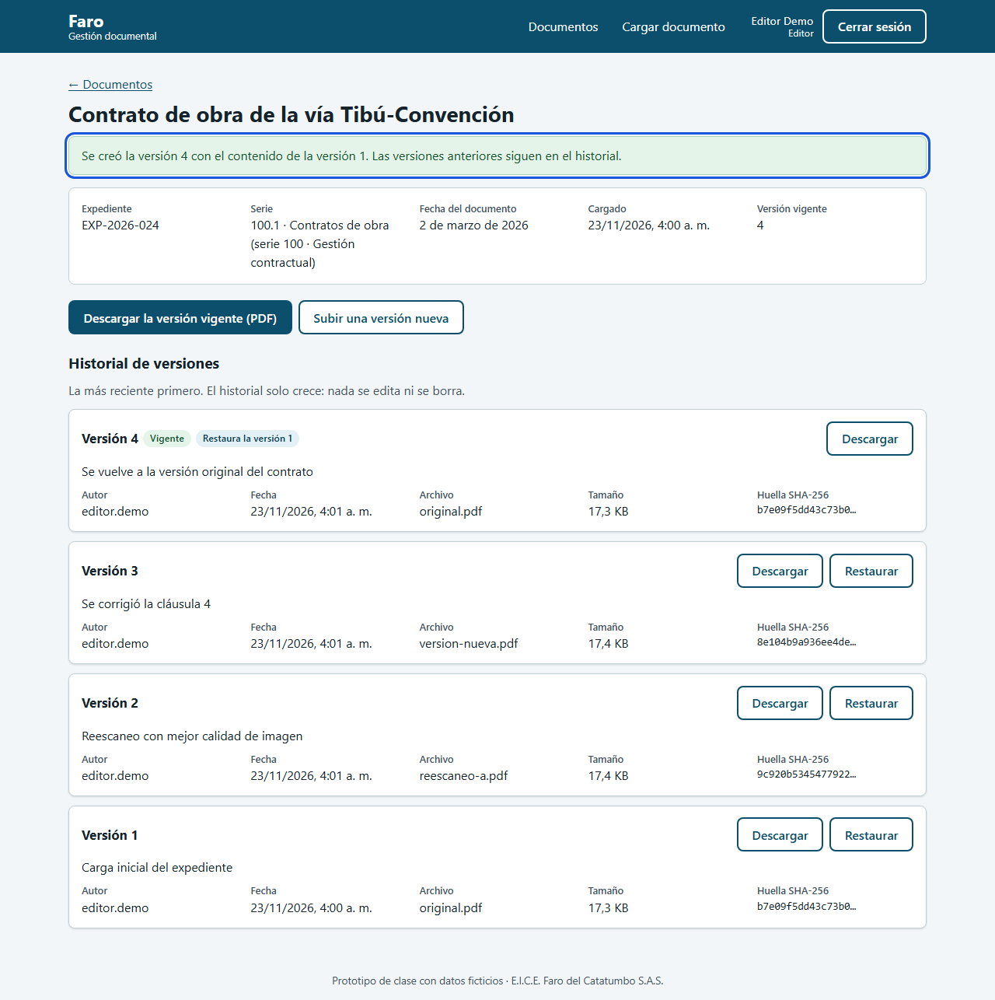

*Captura 32. Resultado de restaurar: la versión 4 repite el contenido de la versión 1 y el historial conserva las anteriores. [CONFIRMADO]*

Si la versión vigente ya tiene ese mismo contenido, el sistema no crea nada y lo explica: «La versión vigente (n) ya tiene el mismo contenido que la versión que quieres restaurar, así que no se creó ninguna versión nueva.» (ADR-0005). Este mensaje no tiene captura en este borrador; sale del código de la interfaz [POR VERIFICAR: verlo en pantalla]. Se puede restaurar una restauración: el historial solo crece.

### Si tu rol es de consulta

El rol de consulta **no ve** los botones «Subir una versión nueva» ni «Restaurar», ni el enlace «Cargar documento» del menú. Si abre a mano la dirección de una pantalla de carga, ve el aviso de falta de permiso. La API también rechaza la acción con un 403, aunque alguien llegue por otro camino.

*Captura 33. El detalle visto como consulta: sin «Subir una versión nueva» ni «Restaurar». [CONFIRMADO]*

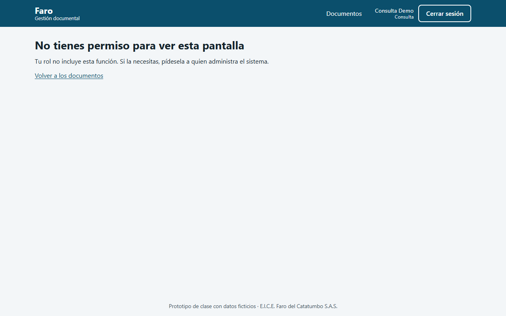

*Captura 34. Un usuario de consulta abre la pantalla de carga: «No tienes permiso para ver esta pantalla». [CONFIRMADO]*

## 10. Administración de usuarios y auditoría (administrador)

> **Estado:** pantallas del PR #62 (issue #25), fusionadas en `main` el 25 de noviembre de 2026, sobre las del PR #58. Las capturas de esta sección son de la rama de ese PR antes de fusionarla (las tomó el carril W el 23 de noviembre sobre la punta `f999713`; las 39 y 43 se rehicieron el 25 de noviembre con la punta `8acb53f`, que corrige dos defectos que ellas mostraban), con datos ficticios [CONFIRMADO]. Solo las ve el rol **administrador**: aparecen en el menú como **Usuarios** y **Auditoría** (direcciones `/app/usuarios` y `/app/auditoria`). Lo que no tiene captura va marcado.

### 10.1 Usuarios

La pantalla **Usuarios** dice «Quién puede ingresar y con qué rol. Los usuarios no se borran: desactivar a alguien cierra sus sesiones y conserva el registro de lo que hizo.» Muestra el resumen («6 usuarios · 4 activos») y una tarjeta por persona con su nombre, su usuario, su **rol**, su **estado** («Activo» o «Inactivo: no puede ingresar») y cuándo se creó. Tu propia tarjeta lleva la etiqueta **Tú**; las de personas desactivadas, la etiqueta **Inactivo** y un borde punteado. Cada tarjeta tiene los botones **Cambiar rol** y **Desactivar** (o **Reactivar**, si la persona está inactiva); con el PR #66 (sección 11) suma **Restablecer clave** o, en tu propia tarjeta, **Cambiar mi clave**. Debajo de la lista, «**Actualizar la lista** por si otro administrador hizo cambios».

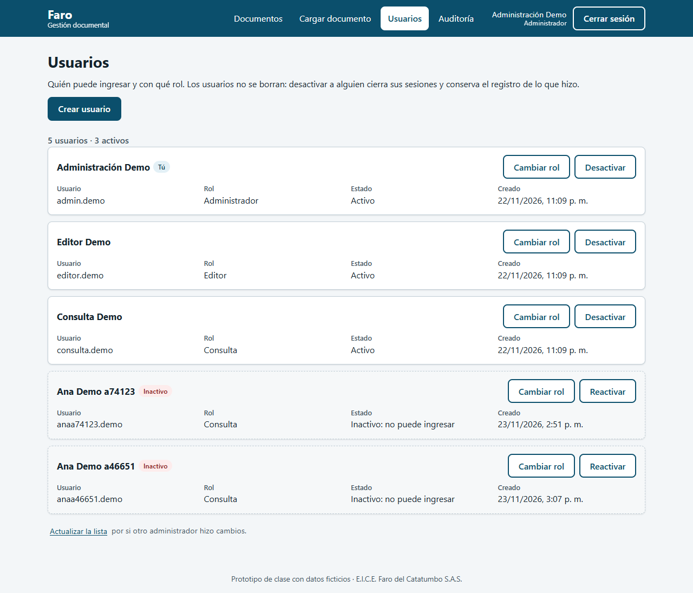

*Captura 35. Lista de usuarios (rol de administrador; PR #62, 1280 px). [CONFIRMADO]*

**Crear un usuario.** Pulsa **Crear usuario**: debajo se abre el formulario «Crear un usuario», que dice «La persona ingresará con el nombre de usuario y la clave inicial que escribas aquí». Tiene cuatro datos:

- **Nombre completo** (obligatorio, hasta 120 caracteres; hay un contador): cómo se mostrará en el sistema.
- **Nombre de usuario** (obligatorio): con él ingresa la persona. De 3 a 64 caracteres: minúsculas sin tilde, números, punto, guion y guion bajo. **No se puede cambiar después.**
- **Rol**: Administrador, Editor o Consulta, cada uno con lo que puede hacer (la misma descripción de la matriz de roles). Viene marcado **Consulta**, el de menos permisos [PROPUESTA] (ADR-0012, sección 7).
- **Clave inicial** (obligatoria): de 12 a 256 caracteres. La **escribe el administrador** [PROPUESTA] (ADR-0012, sección 7): «Escríbela tú y entrégasela a la persona por otro medio, no en el mismo mensaje donde le das su usuario. El sistema no vuelve a mostrarla.» La casilla **Mostrar la clave mientras la escribo** deja verla para no equivocarse.

Los botones son **Crear usuario** y **Cancelar**.

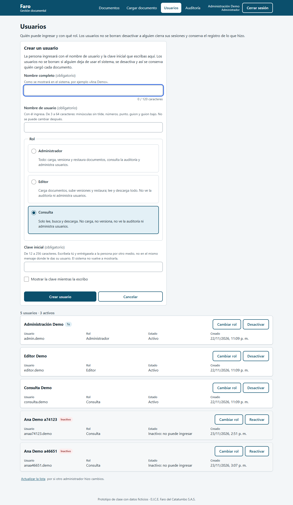

*Captura 36. El formulario de alta, vacío. [CONFIRMADO]*

Si algo falta o está mal, cada campo lo dice en rojo y el cursor va al primero con error:

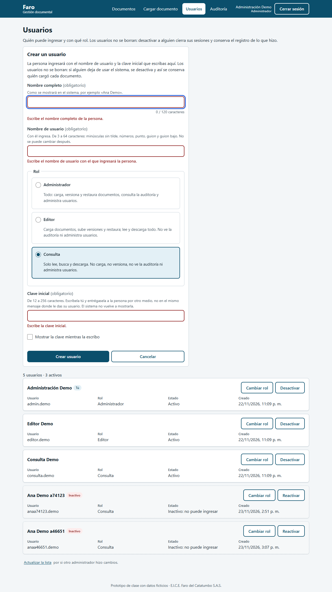

*Captura 37. Se pulsó **Crear usuario** con todo vacío. [CONFIRMADO]*

Otros mensajes del formulario salen del código de la interfaz y no tienen captura en este manual [POR VERIFICAR: verlos en pantalla]: «Escríbelo todo en minúsculas, por ejemplo «…»: el sistema no cambia las mayúsculas por ti.» (el sistema **no** convierte las mayúsculas por la persona); «Mínimo 12 caracteres: esta tiene 11.»; «La clave no puede ser solo espacios.»; y, si el nombre de usuario ya existe, «Ya existe un usuario llamado «…». Elige otro nombre de usuario.»

Al crearlo, la pantalla avisa en verde y la persona aparece en la lista:

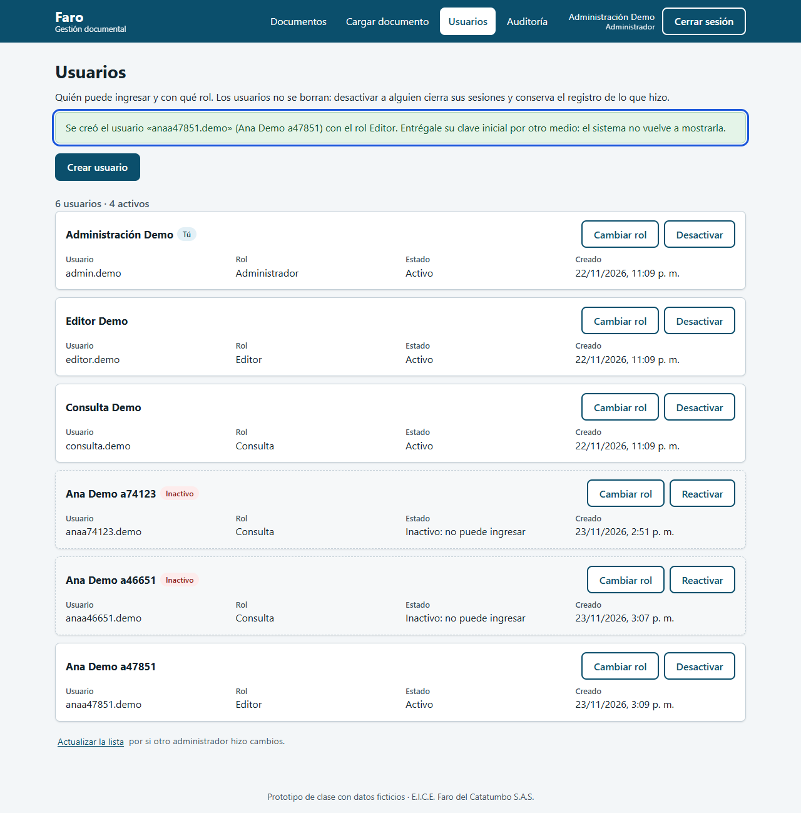

*Captura 38. Usuario creado. La clave inicial no se vuelve a mostrar. [CONFIRMADO]*

Entrégale la clave a la persona **en persona o por una llamada**, no por un grupo de mensajes [PROPUESTA].

**Cambiar el rol.** Pulsa **Cambiar rol** en la tarjeta: se abre el panel «Cambiar el rol de …», con la advertencia «El cambio rige **al instante**, aunque la persona tenga la sesión abierta, y queda en la auditoría.» Elige el rol nuevo (el actual lleva la nota «(rol actual)») y pulsa **Sí, cambiar el rol**; o **Cancelar**. Al terminar: «Se cambió el rol de …: ahora es Consulta. Rige desde ya.» Si confirmas sin haber elegido otro rol, el panel avisa en rojo «Mateo Prueba ya tiene el rol Editor. Elige uno distinto o cancela.» y ese aviso **desaparece en cuanto eliges otro rol** (corregido en la punta `8acb53f` del PR #62; antes se quedaba a la vista aunque ya hubieras elegido otro) [CONFIRMADO].

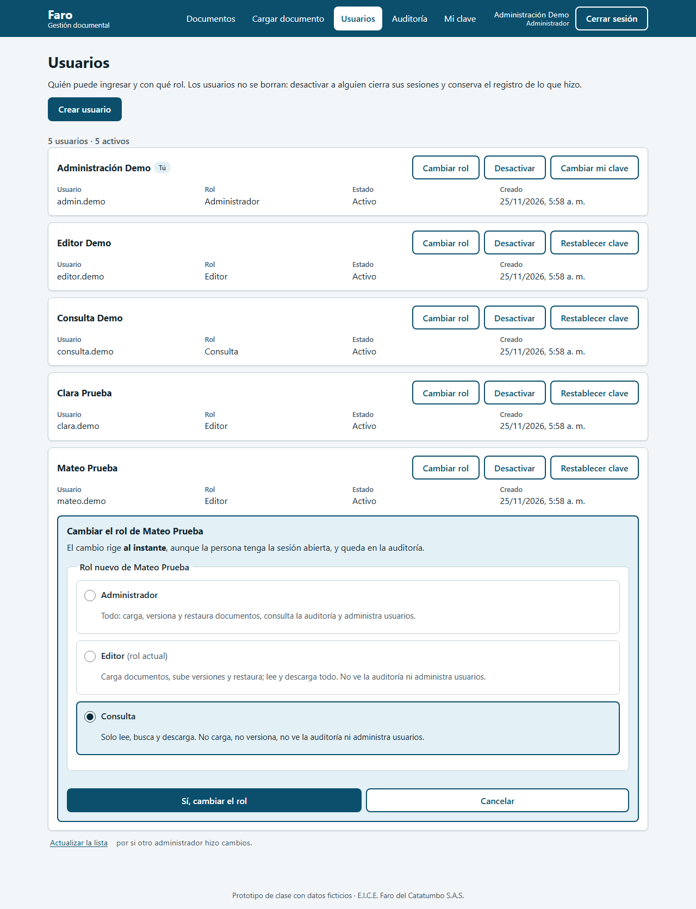

*Captura 39. Panel para cambiar el rol, con Consulta elegido tras haber visto el aviso «ya tiene el rol Editor»: el aviso ya no se queda. Rehecha el 25 de noviembre con la punta `8acb53f` del PR #62 (1280 px). [CONFIRMADO]*

Si cambias **tu propio rol**, el panel añade «**Es tu propia cuenta.** Si dejas de ser administrador, perderás el acceso a esta pantalla en cuanto confirmes.» Y así pasa: la interfaz vuelve a leer tu rol y te muestra «No tienes permiso para ver esta pantalla» (el menú ya no tiene Usuarios ni Auditoría).

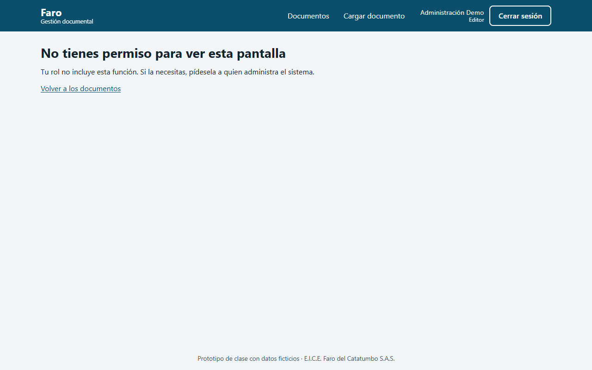

*Captura 40. Un administrador se cambió a Editor: pierde la pantalla de usuarios. [CONFIRMADO]*

**Desactivar y reactivar.** Pulsa **Desactivar**: el panel «¿Desactivar a …?» explica que la persona «**no podrá ingresar** y sus sesiones abiertas se cierran **al instante**. No se borra nada: lo que cargó y su historial siguen a su nombre, y puedes reactivarla cuando quieras. Queda en la auditoría.» El botón rojo **Sí, desactivar** lo confirma. Al terminar: «Se desactivó a …. Sus sesiones se cerraron y ya no puede ingresar.»

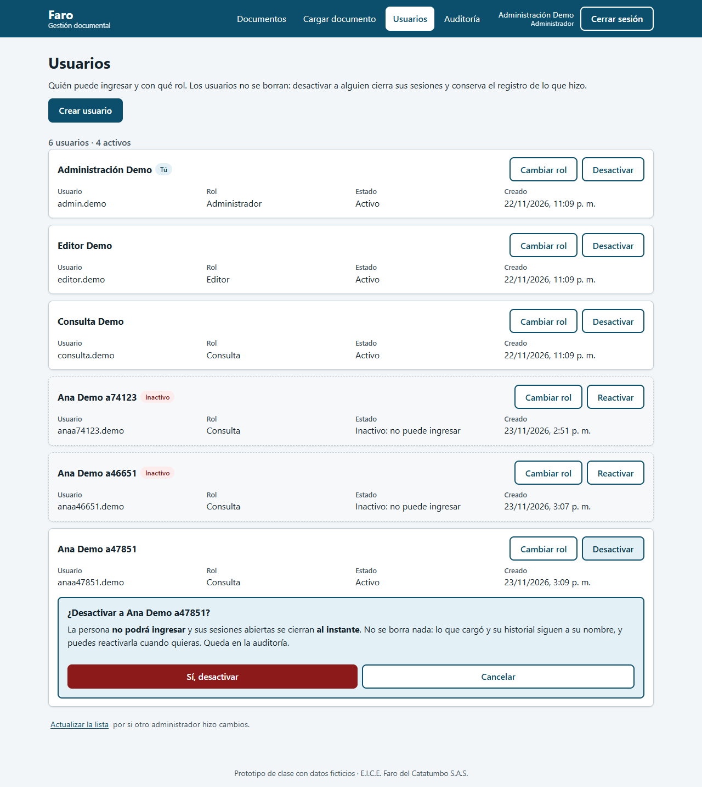

*Captura 41. Confirmación para desactivar a otra persona. [CONFIRMADO]*

Si desactivas **tu propia cuenta**, el panel añade «**Es tu propia cuenta.** Tu sesión se cerrará ahora mismo y no podrás volver a ingresar hasta que otro administrador te reactive.» Al confirmar, la interfaz te lleva a la pantalla de ingreso (ADR-0012, sección 7.1) [POR VERIFICAR: sin captura en este manual; el texto sale del código y se comprobó en una captura de trabajo].

Para devolverle el acceso a alguien, pulsa **Reactivar** en su tarjeta; no pide confirmación y avisa «Se reactivó a …. Ya puede ingresar de nuevo.» [POR VERIFICAR: sin captura en este manual]. Las sesiones que se cerraron al desactivarla no vuelven: la persona tiene que ingresar de nuevo.

**El último administrador.** El sistema **no deja desactivar ni cambiar el rol del último administrador activo** (ADR-0008, «ultimo_administrador»). La pantalla lo explica en el mismo panel y lo deja abierto:

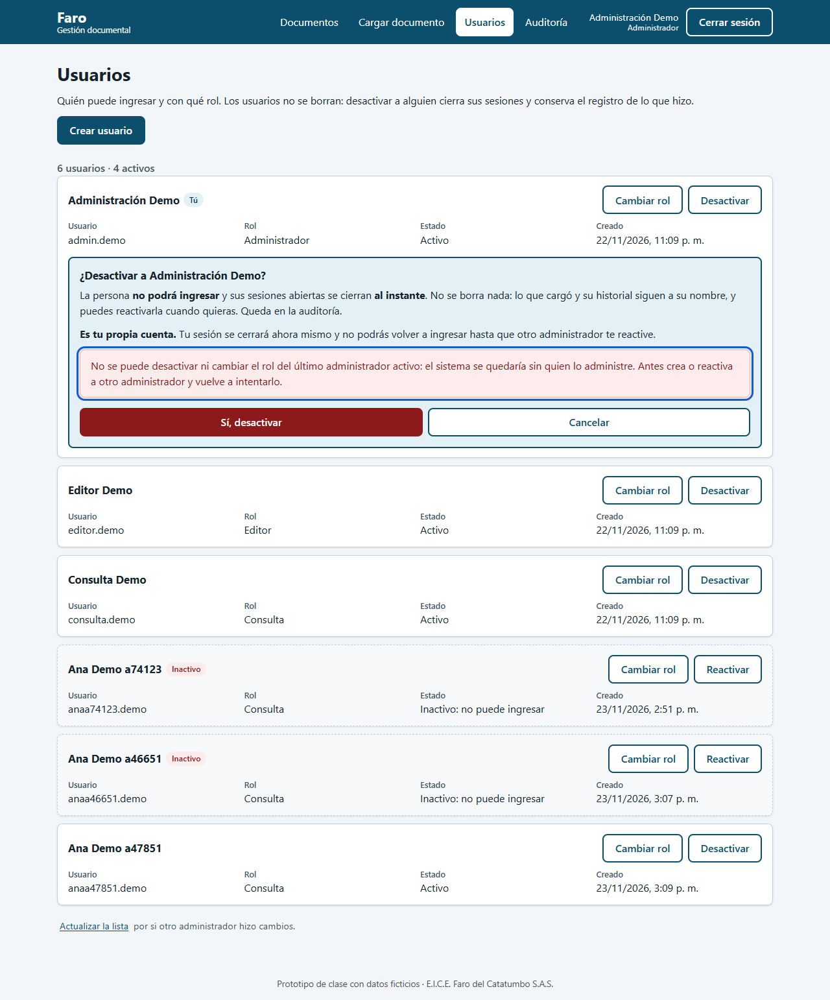

*Captura 42. Intento de desactivar al único administrador activo. [CONFIRMADO]*

**Otras reglas:** no se puede cambiar el nombre ni el nombre de usuario después de crear la cuenta; nadie se borra; y cualquier cambio queda en la auditoría (sección 10.2). Si otro administrador hizo cambios mientras tenías la pantalla abierta, pulsa **Actualizar la lista**. Una persona con rol de editor o de consulta que abra `/app/usuarios` ve «No tienes permiso para ver esta pantalla» (captura 34) y la API también responde 403.

Otros mensajes de error (sin conexión, sesión vencida, demasiadas peticiones) salen del código de la interfaz (`apps/web/src/api/errores-administracion.ts`); los de cambios dicen, por ejemplo, «No se pudo conectar con el servidor. Revisa tu conexión e intenta de nuevo. Antes de repetirlo, actualiza la lista: puede que el cambio sí se haya hecho.» [POR VERIFICAR: verlos en pantalla].

### 10.2 Auditoría

La auditoría es el **registro de lo que ocurre en el sistema**. **No se puede editar ni borrar**, ni por la API ni con comandos SQL normales (un disparador de la base lo impide; README y `docs/modelo-de-datos.md`). La pantalla **Auditoría** es **solo de consulta**: «Lo que ha pasado en el sistema: ingresos, cargas, descargas, versiones y cambios de usuarios, del más reciente al más antiguo. Solo se consulta: ningún evento se puede editar ni borrar. Las horas son las de Colombia.»

Cada evento sale en una tarjeta con:

- **El nombre de la acción** («Ingreso», «Rol de usuario cambiado», «Acceso denegado»…) y, a la derecha, el **día y la hora de Colombia** (por ejemplo, 23/11/2026, 3:09:24 p. m.).
- **Quién**: el usuario que la hizo, o «Sin identificar» (un ingreso fallido de alguien que no existe no tiene usuario).
- **Documento**: un enlace «Documento 12» que lleva al detalle, o «—» si el evento no es de un documento.
- **Detalle**: un texto breve (por ejemplo, «usuario 11 (anaa47851.demo); rol administrador → consulta» o «desde clave temporal; otras sesiones cerradas: 1»), o «—». Para un **«Acceso denegado»** el detalle dice, con palabras, «Intentó hacer algo que su rol no permite; no se le concedió el acceso.» (la API sigue guardando el texto técnico completo, con método, ruta y roles; la pantalla solo lo traduce; punta `8acb53f` del PR #62, antes mostraba «GET /auditoria; requiere administrador; tiene consulta») [CONFIRMADO]. **Excepción** [CONFIRMADO en la rama local descartable que juntaba #62, #57 y #66; el código de `main` es el mismo]: el acceso denegado porque la clave es temporal (sección 11.2) sigue mostrando el texto técnico («GET /documentos; cambio de clave requerido»), porque la traducción solo reconoce el formato del rol (captura 43).

Salen **20 eventos por página**; abajo están **Anterior**, «Página 1 de 2» y **Siguiente**. Arriba de la lista, «24 eventos» y el enlace **Actualizar**.

*Captura 43. Lista de auditoría sin filtros (rol de administrador, 1280 px), rehecha el 25 de noviembre con la interfaz de `8acb53f` (PR #62) en una rama local descartable que juntaba #62, #57 y #66: por eso aparecen también «Clave cambiada» y «Rol de usuario cambiado» y un acceso denegado por clave temporal. Los eventos son de pruebas con usuarios ficticios. [CONFIRMADO]*

**Filtros.** Se combinan, y se aplican al pulsar **Filtrar**:

| Filtro | Qué hace |
|---|---|
| **Usuario** | Quién hizo la acción; el menú muestra «Nombre (usuario)» y marca a los inactivos. «Los ingresos fallidos no tienen usuario y no se pueden filtrar así.» |
| **Acción** | Una de las 14 acciones que ofrece hoy la pantalla (ver abajo), o «Todas las acciones». |
| **Número de documento** | El número que sale en la dirección del documento. Solo cifras: «Escribe solo el número del documento, por ejemplo 12.» |
| **Desde** y **Hasta** | Un día completo en la hora de Colombia: «Desde» es el primer instante de ese día y «Hasta», el último [PROPUESTA] (ADR-0012, sección 7). Si «desde» es posterior a «hasta»: «La fecha «desde» no puede ser posterior a «hasta».» |

Con algún filtro puesto, el total dice «3 eventos con estos filtros» y aparece **Quitar filtros**. Si nada coincide: «Ningún evento coincide con los filtros. Prueba con otro rango de fechas o quita los filtros.» Los filtros y la página quedan en la dirección del navegador, así que puedes copiarla y compartirla.

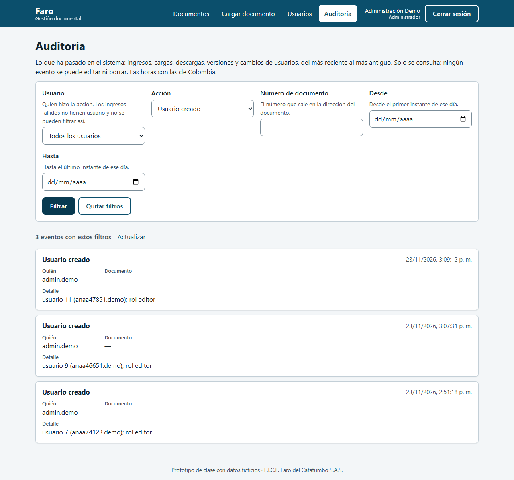

*Captura 44. Filtro por acción «Usuario creado»: tres eventos. [CONFIRMADO]*

El filtro de **Acción** ofrece: Ingreso, Ingreso fallido, Ingreso bloqueado, Cierre de sesión, Acceso denegado, Carga de documento, Descarga de documento, Versión nueva, Restauración de versión, Decisión ante un duplicado, Usuario creado, Rol de usuario cambiado, Usuario desactivado y Usuario reactivado (las 14 de `ACCIONES_FILTRABLES`). **Todavía no ofrece** «Cuadro de clasificación importado» (PR #55), «Clave cambiada» y «Clave restablecida» (PR #57), aunque esos PR ya están en `main` [PENDIENTE: agregarlas al filtro] (ADR-0012, sección 7). Mientras tanto esos eventos se ven en la lista general con su nombre.

Solo el administrador la consulta. Registra, entre otras cosas:

| Qué se registra | Cuándo |
|---|---|
| Ingreso, cierre de sesión | Al ingresar y al salir |
| Ingreso fallido (sin guardar lo que se escribió) y bloqueo por demasiados intentos | Al fallar o agotar el límite |
| Acceso denegado | Cuando alguien intenta algo que su rol no permite (o abre algo mientras su clave es temporal) |
| Carga | Al cargar un documento |
| Versión y restauración | Al subir una versión nueva o restaurar una |
| Descarga | Al descargar una versión |
| Decisión ante un duplicado | Cuando alguien decide qué hacer ante el aviso (con su justificación o motivo) |
| Usuario creado, rol cambiado, usuario desactivado o reactivado | Al administrar usuarios |
| Clave cambiada y clave restablecida | Al cambiar o restablecer una clave (nunca se guarda la clave ni su huella) *(PR #57; se vieron en la lista de la captura 43 y en la sección 11)* |
| Cuadro de clasificación importado | Al importar el cuadro desde un CSV *(PR #55)* |

## 11. Cambiar la clave y restablecer la de otra persona

> **Estado:** pantallas del PR #66 (issue #51), fusionadas en `main` el 25 de noviembre de 2026 sobre la API de las claves del PR #57 (ADR-0011), que se fusionó antes. Las capturas de esta sección son de datos ficticios (usuarios `*.demo` y claves inventadas), tomadas el 25 de noviembre, **antes de fusionar**, en una **rama local descartable** que juntaba las ramas de los PR #66 (punta `5a6bffa`) y #57 (punta `4cbfa2b`), compilada y probada con una base de datos propia que se borró al terminar; esa rama no se subió a ningún repositorio [CONFIRMADO]. El código de la interfaz de `main` es idéntico al de la punta `5a6bffa` [CONFIRMADO: `git diff 5a6bffa origin/main -- apps/web/src` sin diferencias], así que lo que muestran las capturas es lo que hay en `main`. Lo que no tiene captura va marcado.

### 11.1 Cambiar tu propia clave

Cualquier rol puede hacerlo. Se entra por el enlace **Mi clave** del menú (dirección `/app/clave`) o, si eres administrador, por el botón **Cambiar mi clave** de tu tarjeta en Usuarios; en esa tarjeta no hay «Restablecer clave», porque la propia clave no se restablece. La pantalla «Cambiar mi clave» dice «Elige una clave nueva. Para hacerlo tienes que escribir primero la que usas hoy. Al cambiarla, las demás sesiones abiertas con tu usuario (en otros equipos o navegadores) se cierran; esta sigue abierta.»

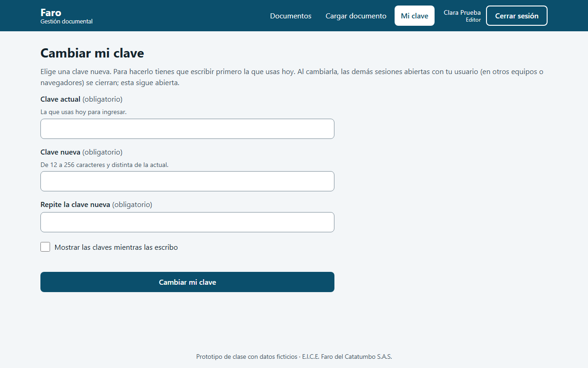

*Captura 45. «Cambiar mi clave» abierta desde el menú, de forma voluntaria (rol de editor, 1280 px). [CONFIRMADO]*

Tiene tres campos y una casilla:

- **Clave actual** (obligatorio): «La que usas hoy para ingresar.»
- **Clave nueva** (obligatorio): «De 12 a 256 caracteres y distinta de la actual.»
- **Repite la clave nueva** (obligatorio).
- La casilla **Mostrar las claves mientras las escribo**.

El botón es **Cambiar mi clave**. Si sale bien, en lugar del formulario aparece «Tu clave cambió. Las demás sesiones abiertas con tu usuario se cerraron; esta sigue abierta.» (captura 48) con un botón: **Continuar** si tu clave era temporal y **Volver** si la cambiaste por gusto [CONFIRMADO: «Continuar» en la captura 48; «Volver» sale del código y no tiene captura]. Las otras sesiones se cierran de verdad: la prueba lo comprobó con una segunda sesión de la misma persona, que dejó de servir (401) y quedó anotado en la auditoría como «Clave cambiada» («desde clave temporal; otras sesiones cerradas: 1») [CONFIRMADO].

Mensajes que puedes ver: «Escribe tu clave actual.», «Escribe la clave nueva.», «Mínimo 12 caracteres: esta tiene 11.», «La clave nueva debe ser distinta de la actual.», «Vuelve a escribir la clave nueva para confirmarla.» y «No coincide con la clave nueva. Vuelve a escribirla.» [POR VERIFICAR: salen del código de la rama; solo se vio en pantalla el de la clave actual incorrecta, en la sección 11.2]. Tras varios intentos fallidos con la clave actual el sistema se protege como en el ingreso: «Demasiados intentos con la clave actual. Intenta de nuevo en …; mientras tanto tampoco podrás ingresar.» (comparte el límite con el ingreso, según el código; [POR VERIFICAR: sin captura]).

### 11.2 Si tu clave es temporal

Si un administrador te restableció la clave, al ingresar con la clave temporal el sistema te lleva a «Cambiar mi clave» y **no te deja abrir nada más**: el menú desaparece (solo quedan tu nombre, tu rol y **Cerrar sesión**) hasta que elijas una clave propia. La pantalla avisa: «**Tu clave es temporal.** Un administrador la restableció. Antes de seguir tienes que elegir una clave propia: mientras no lo hagas, el sistema no te deja abrir nada más.» En «Clave actual» escribes la clave temporal («La clave temporal que te entregó el administrador.»).

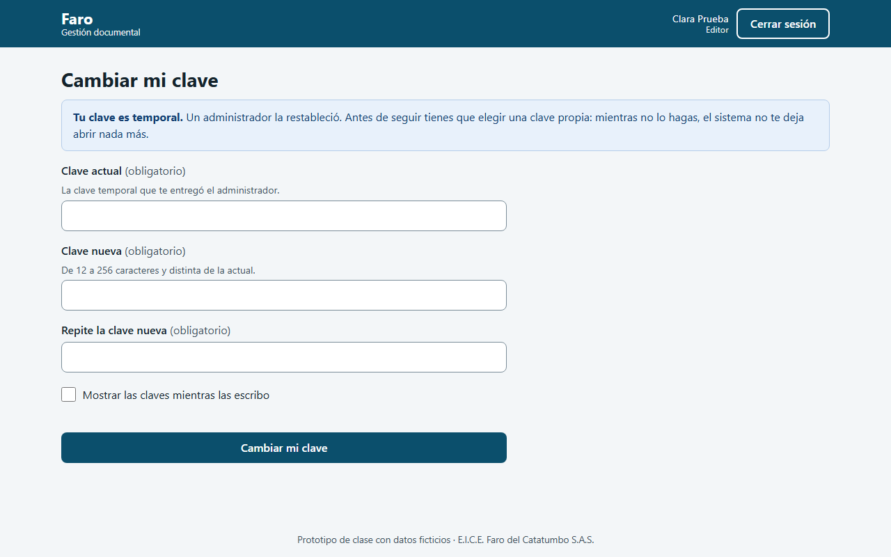

*Captura 46. Primer ingreso con una clave temporal: sin menú y con el aviso (1280 px). [CONFIRMADO]*

Si escribes a mano la dirección de otra pantalla (por ejemplo, `/app/documentos`), el sistema te devuelve a esta, y la API responde 403 a cualquier otra petición hasta que cambies la clave [CONFIRMADO: ambas cosas se comprobaron en la prueba]. Si la «Clave actual» no es la temporal, el error sale **en el campo**, no como una sesión vencida:

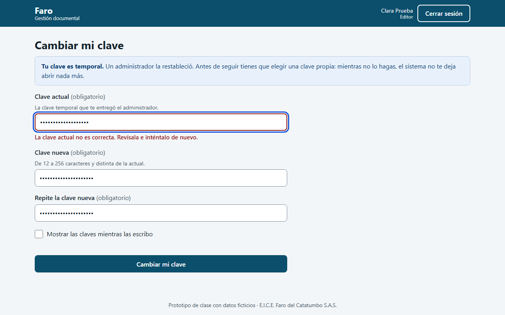

*Captura 47. Clave actual equivocada: «La clave actual no es correcta. Revísala e inténtalo de nuevo.» [CONFIRMADO]*

Cuando la cambias bien, aparece el aviso en verde y el botón **Continuar**, que te lleva a **Documentos**; el menú completo vuelve a aparecer [CONFIRMADO]:

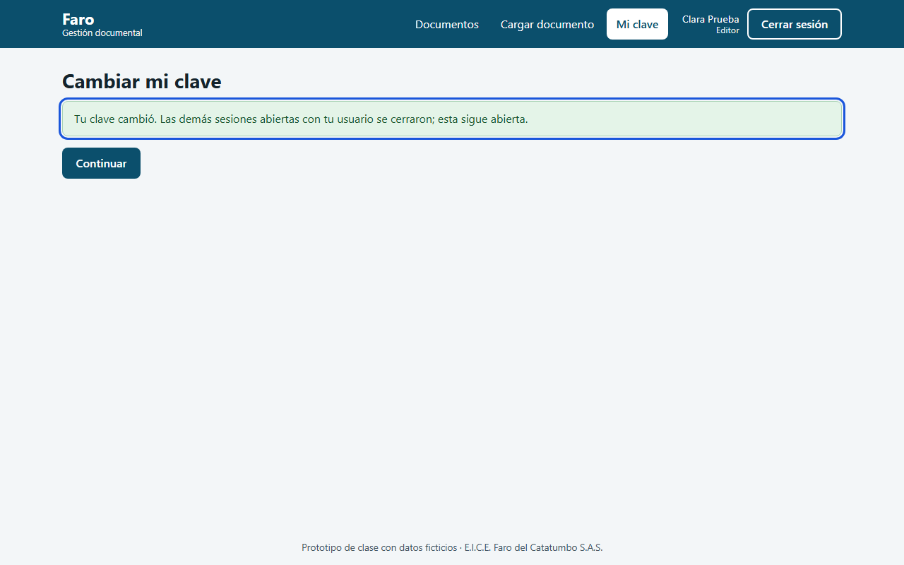

*Captura 48. Clave cambiada: «Continuar» (1280 px). [CONFIRMADO]*

Si la API rechaza una acción porque tu clave sigue siendo temporal (403 «cambio_de_clave_requerido»), la interfaz lo explica con «Tu clave es temporal: antes de hacer cualquier otra cosa tienes que cambiarla.» [POR VERIFICAR: texto del código; en la prueba no llegó a verse porque la interfaz ya te lleva a «Cambiar mi clave»]. Ese rechazo queda en la auditoría como «Acceso denegado» con el detalle técnico «GET /documentos; cambio de clave requerido» (sección 10.2).

### 11.3 Restablecer la clave de otra persona (administrador)

En **Usuarios**, cada tarjeta de **otra persona** tiene el botón **Restablecer clave**. En tu propia tarjeta, en su lugar, está **Cambiar mi clave**: la clave propia no se restablece (si la API lo rechaza con un 409, la interfaz explica «La clave de tu propia cuenta no se restablece desde aquí: usa «Cambiar mi clave» para elegir una nueva.» [POR VERIFICAR: texto del código; sin captura]).

El panel «Restablecer la clave de …» avisa que la persona «**no podrá ingresar con su clave actual**» y que sus sesiones abiertas se cierran **al instante**; que con la clave temporal el sistema le pedirá elegir una propia antes de dejarle hacer otra cosa; y que queda en la auditoría. Pide la **Clave temporal** (de 12 a 256 caracteres): la escribes tú o pulsas **Generar una clave**. La casilla **Mostrar la clave mientras la escribo** deja verla. Los botones son **Sí, restablecer la clave** (rojo) y **Cancelar**. Si la dejas vacía: «Escribe la clave temporal o genera una.» [POR VERIFICAR: texto del código; sin captura].

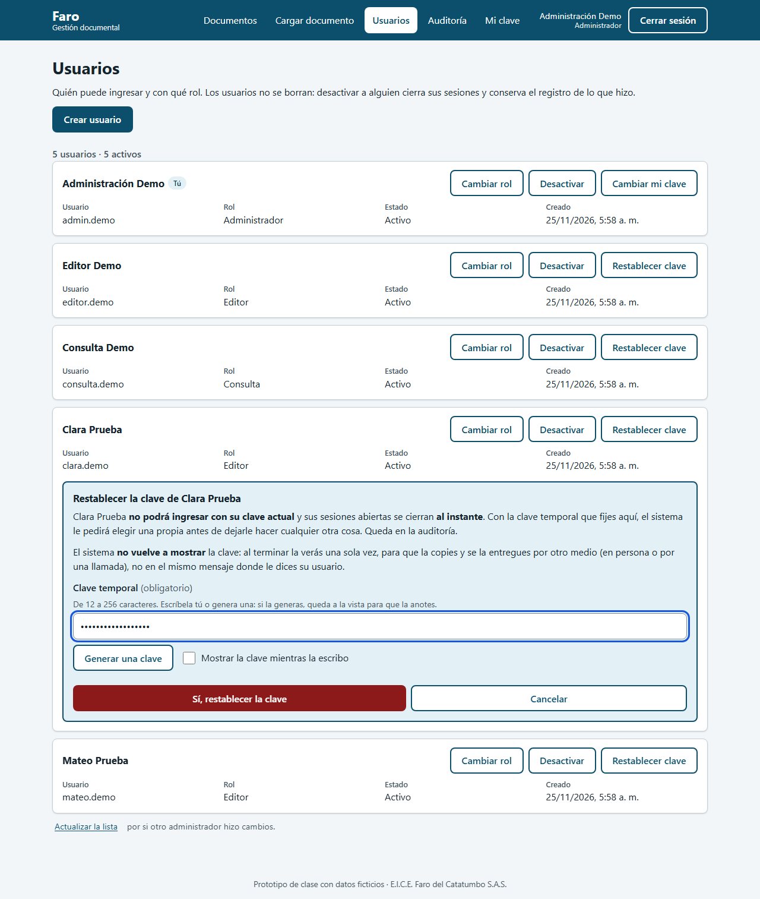

*Captura 49. Restablecer la clave de otra persona escribiendo una clave temporal (se ve oculta). [CONFIRMADO]*

Con **Generar una clave**, el navegador crea una clave al azar [PROPUESTA] y **la deja a la vista** para que la anotes: 16 letras y cifras en cuatro grupos separados por guion (por ejemplo, `5fu3-bH2N-zhwc-byrs`), sin los símbolos que se confunden al dictarlos por teléfono (0, O, 1, l, I) [CONFIRMADO en la captura y en el código; la clave de la captura es ficticia, de una base descartable].

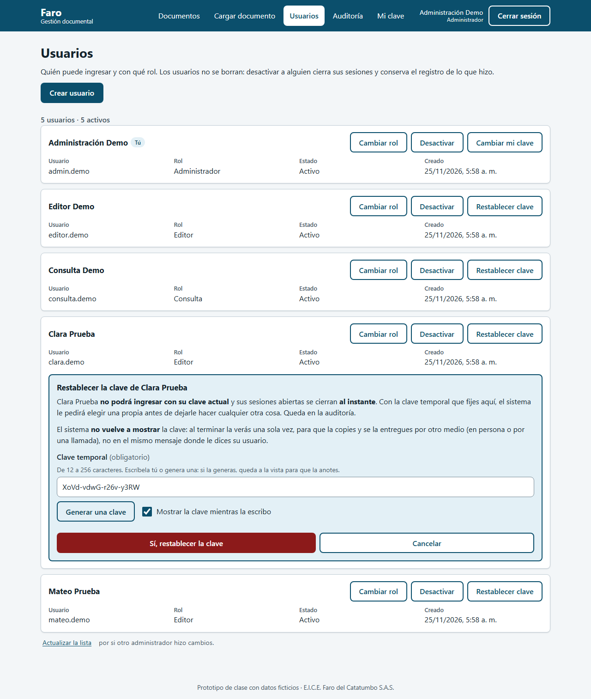

*Captura 50. Clave temporal generada por el sistema, a la vista. [CONFIRMADO]*

Al confirmar, la pantalla muestra **una sola vez** la clave temporal, en el recuadro «Clave temporal de …»: en un campo de solo lectura, con el botón **Copiar la clave** («Clave copiada. Pégala solo donde vayas a entregarla.»; si el navegador no deja copiar: «No se pudo copiar. Selecciona la clave del campo y cópiala a mano.» [POR VERIFICAR: sin captura]). El aviso lo dice con todas las letras: «**Esta es la única vez que se muestra.** El sistema no la guarda y no puede volver a mostrarla: si la pierdes, restablece la clave otra vez. Entrégasela a … por otro medio, no en el mismo mensaje donde le dices su usuario.» El botón **Ya la copié, cerrar** la oculta. Mientras el recuadro está abierto, los botones «Restablecer clave» de las demás tarjetas quedan desactivados.

*Captura 51. La clave temporal, mostrada una sola vez. [CONFIRMADO]*

Entrégala **en persona o por una llamada** [PROPUESTA]. La clave temporal solo vive en la pantalla: no va a la dirección del navegador ni a su almacenamiento (según el comentario del código de la interfaz). Quedan en la auditoría «Clave restablecida» (con la persona y cuántas sesiones se cerraron, nunca la clave: «usuario 4 (clara.demo); sesiones cerradas: 0») y, cuando ella la cambia, «Clave cambiada» [CONFIRMADO en la rama descartable]. La persona restablecida **no puede ingresar con su clave anterior**; con la temporal, sí, y le sale la pantalla de la sección 11.2.

## 12. Preguntas frecuentes

**¿Puedo borrar un documento o una versión?** No. El historial solo crece, por diseño: es lo que sirve de evidencia ante un ente de control. Si subiste algo por error, sube una versión nueva o restaura otra, y el error queda a la vista en el historial.

**El sistema no me deja subir un archivo porque «ya está en el sistema». ¿Por qué?** Porque es idéntico, byte por byte, a uno ya cargado. El mismo archivo no se carga dos veces. Abre el documento que ya existe; si tienes una corrección, súbela como versión nueva (sección 7, caso a).

**Subí un PDF escaneado y la búsqueda no lo encuentra por su contenido.** Probablemente el PDF no tiene capa de texto (es una imagen). Se encuentra por el título y el expediente. El detalle de la versión lo avisa con «Sin capa de texto…». El sistema no hace OCR por su cuenta (ADR-0006).

**¿Quién ve los documentos que subo?** Todas las personas con sesión, de cualquier rol. No hay permisos por documento.

**¿Mis acciones quedan registradas?** Sí: ingreso, cargas, versiones, restauraciones, descargas, decisiones ante duplicados, accesos denegados y los cambios de usuarios. Solo el administrador ve la auditoría (sección 10.2).

**¿Por qué mi sesión se cerró?** Vence a las 8 horas sin usarla, o a los 7 días aunque la uses; también se cierra si un administrador te desactiva (o restablece tu clave) y las demás sesiones se cierran cuando cambias tu clave (sección 11, [CONFIRMADO] en la rama local descartable que juntaba #57 y #66).

**¿Cómo le doy acceso a una persona nueva?** Un administrador la crea en **Usuarios** (sección 10.1), elige su rol y le entrega la clave inicial por otro medio.

**Olvidé mi clave. ¿Qué hago?** La pantalla de ingreso no tiene un enlace de «Olvidé mi clave» (captura 1). Pídele a un administrador que te restablezca la clave: te entrega una clave temporal y el sistema te pide elegir una propia (sección 11) [CONFIRMADO: la pantalla es la del PR #66 y la API, la del PR #57; los dos están en `main` desde el 25 de noviembre de 2026]. Si quien olvida la clave es el **único administrador**, no hay salida por la pantalla ni por la API [POR VERIFICAR: un comando de emergencia con acceso a la base, ADR-0011].

**¿Qué pasa si dos personas suben una versión del mismo documento a la vez?** Cada una recibe un número distinto y consecutivo; no se pierde ninguna (ADR-0005).

**¿Se puede usar en el celular?** Sí, desde 360 px de ancho (capturas 9, 26 y 30). [POR VERIFICAR] con personas usuarias reales y con navegadores distintos de Chromium (ADR-0012).

**¿Qué es la «huella SHA-256» del historial?** Un código que identifica el contenido exacto del archivo. Si dos versiones tienen la misma huella, son el mismo archivo.

**¿Esto es el sistema definitivo de la entidad?** No. Es un prototipo de un proyecto de clase, con datos ficticios, y su cuadro de clasificación es provisional. No incluye las TRD y TVD definitivas ni la digitalización del archivo histórico (`CHANGELOG.md`, «Lo que NO incluye v2.0.0»).

## 13. Errores comunes

| Lo que ves | Qué significa | Qué hacer |
|---|---|---|
| «Usuario o clave incorrectos» | Usuario o clave mal escritos, o usuario desactivado | Revisa mayúsculas y espacios. Si sigue, pide ayuda al administrador |
| «Demasiados intentos de ingreso. Intenta de nuevo en 15 minutos.» | Superaste el límite de intentos | Espera el tiempo indicado |
| «Tu sesión terminó. Ingresa de nuevo para continuar.» | La sesión venció o te desactivaron | Ingresa de nuevo |
| «No tienes permiso para ver esta pantalla» | Tu rol no incluye esa función | Pídela a quien administra el sistema |
| «El documento no existe» | La dirección es incorrecta o el documento ya no está | Vuelve al listado |
| «Esta página no existe» | La dirección no es una pantalla de Faro | Usa el enlace «Ir a los documentos» |
| «No se pudo conectar con el servidor. Revisa tu conexión e intenta de nuevo.» | Sin internet, o el servidor está apagado | Revisa tu conexión y reintenta |
| «El servidor tuvo un problema. Intenta de nuevo en unos minutos.» | Falla del servidor | Reintenta; si persiste, avisa al administrador |
| Un botón de **Reintentar** en el listado o el detalle | Falló la carga de datos | Pulsa **Reintentar** |
| «Ningún documento coincide con lo que buscaste…» | La búsqueda o el filtro no tiene resultados | Prueba con otras palabras o pulsa **Quitar filtros** |
| «Ya existe un usuario llamado «…». Elige otro nombre de usuario.» | Al crear un usuario, ese nombre de usuario ya está tomado | Elige otro (sección 10.1) [POR VERIFICAR: sin captura en este manual] |
| «No se puede desactivar ni cambiar el rol del último administrador activo…» | Siempre tiene que haber un administrador activo | Crea o reactiva a otro administrador y repite (captura 42) |
| «Tu clave es temporal: antes de hacer cualquier otra cosa tienes que cambiarla.» | Entraste con una clave temporal (PR #57) | Elige una clave propia en «Cambiar mi clave» (sección 11.2) [POR VERIFICAR: texto del código de la interfaz; el aviso de la pantalla, «Tu clave es temporal.», sí tiene captura, la 46] |
| «La clave actual no es correcta. Revísala e inténtalo de nuevo.» | Al cambiar tu clave, la «Clave actual» está mal escrita | Escríbela de nuevo; tras varios fallos hay que esperar (sección 11.1) [CONFIRMADO: captura 47; la espera sale del código] |

Los mensajes de la carga, la versión nueva y la restauración están en las secciones 7, 8 y 9; los de usuarios y auditoría, en la 10; los de clave, en la 11. Los que no tienen captura salen del código de la interfaz y están marcados [POR VERIFICAR].

## 14. Pendientes de este borrador

Lo que falta antes de convertirlo en la versión final:

1. **Capturas que faltan** [PENDIENTE]: en la sección 11 (clave), los mensajes de validación («Mínimo 12 caracteres…»), el botón «Volver» de quien cambia la clave por gusto, el 429 «Demasiados intentos con la clave actual», el 409 de la clave propia, «Copiar la clave» y las pantallas de clave a 360 px (las capturas 45 a 51 son de 1280 px); el mensaje de restaurar una versión que ya es la vigente (sección 9), el resultado de «Es otro documento» y, en usuarios (sección 10.1), desactivar la propia cuenta, reactivar, el nombre de usuario repetido y el error de fechas de la auditoría (existen capturas de trabajo del carril W, no incluidas aquí por peso). Las de carga, duplicado (incluida la lista de varios candidatos, capturas 19 a 21, tomadas tras el arreglo `cac8cfe`), versión nueva y restaurar existen (capturas 12 a 34); las de usuarios y auditoría, también (capturas 4 y 35 a 44; la 39 y la 43 se rehicieron con la punta `8acb53f`); y las de clave (capturas 45 a 51). Todas se rehacen si cambian la interfaz o la API.
2. **Confirmar los textos** sin captura de las secciones 7 a 10 contra las pantallas reales. Los textos con captura se leyeron de la pantalla y del código de los PR #58 (commits `a6d6eb1` y `cac8cfe`) y #62 (puntas `f999713` y `8acb53f`), que ya están en `main`; si cambia la interfaz hay que repasarlos y rehacer las capturas.
3. **La sección 11 (clave)** se escribió con las pantallas reales (capturas 45 a 51), tomadas en una rama local descartable que juntaba el PR #66 (punta `5a6bffa`) y el PR #57 (punta `4cbfa2b`) antes de fusionar; los textos entre « » se comprobaron con `git grep -F` contra esas ramas y, al poner el manual al día el 25 de noviembre, contra `main`. Los dos PR ya están en `main` y el código de la interfaz es el mismo: hay que repasar la sección y rehacer las capturas solo si cambian la interfaz o la API.
4. **Quién redacta la versión final** [POR VERIFICAR]: César (parte académica) o Juan (parte técnica). Los dos revisan.
5. **Revisión con personas que usen el sistema** (ingeniería, jurídica, contabilidad, gerencia): este texto no se ha probado con nadie [SUPUESTO] que sea claro.
6. **Hallazgos de interfaz del PR #62** [CONFIRMADO: corregidos en 8acb53f]: (a) en el panel de cambiar el rol, el aviso «ya tiene el rol …» se quedaba a la vista aunque se eligiera otro rol; ahora desaparece al elegir otro (captura 39, rehecha); (b) el detalle de un «Acceso denegado» era texto técnico («GET /auditoria; requiere administrador; tiene consulta»); ahora dice «Intentó hacer algo que su rol no permite; no se le concedió el acceso.» (captura 43, rehecha). **Hallazgo nuevo** [CONFIRMADO en la rama local descartable que juntaba #62, #57 y #66; el código de `main` es el mismo]: el «Acceso denegado» por clave temporal se sigue mostrando con el texto técnico («GET /documentos; cambio de clave requerido»), porque la traducción de `8acb53f` solo reconoce el formato de la guarda de roles (`detalleVisible`, `apps/web/src/utilidades/auditoria.ts`); el #66 se fusionó con ese texto; conviene decidir si también se traduce [PROPUESTA].
7. **Capturas descartadas:** la del formulario de alta «lleno» del carril W (c25-04) se dejó fuera porque era incoherente (mostraba el aviso de las minúsculas con el nombre de usuario ya en minúsculas y otro de la clave que no correspondía a lo escrito; [SUPUESTO] son errores que quedaron de un intento anterior). Las demás capturas de trabajo del PR #62 no incluidas (por peso o por repetir otra) son: nombre de usuario repetido, usuario desactivado, desactivarse a sí mismo, sin permiso de un usuario de consulta (equivale a la captura 34), filtros por usuario y fechas, error de fechas, segunda página, ingresos fallidos, y las versiones a 360 px.
8. **Filtro de acciones de la auditoría** [PENDIENTE]: ofrece 14 acciones y le faltan `ccd_importado` («Cuadro de clasificación importado»), `clave_cambiada` y `clave_restablecida`, aunque esos eventos ya existen en `main` (`apps/web/src/utilidades/auditoria.ts`, constante `ACCIONES_FILTRABLES`). Se ven en la lista general con su nombre.
9. **Salida de emergencia para el único administrador** [POR VERIFICAR]: si quien olvida su clave es el único administrador no hay cómo restablecerla por la API ni por la pantalla; el ADR-0011 propone un comando `restablecer-clave` con acceso a la base de datos, que no se construyó.

## 15. Fuentes

- Capturas: `docs/manual/capturas/` (datos ficticios; 51 en total: 1 a 3 y 5 a 11 de la interfaz del PR #54, 12 a 34 de la del PR #58, 4 y 35 a 44 de la del PR #62, y 45 a 51 de la del PR #66 con la API del PR #57; casi todas a 1280 px y algunas a 360 px). Cada archivo empieza por el número de su captura. Las capturas 45 a 51 (y las rehechas 39 y 43) salen de una rama local descartable, nunca subida, con base de datos propia y claves inventadas.
- Código de la interfaz leído en las ramas de los PR #54 (`feat/23-web-listado`), #58 (`feat/24-web-carga`), #62 (`feat/25-web-admin`) y #66 (`feat/51-web-clave`; solo la sección 11), y el de la API de las claves en la del PR #57 (`feat/51-cambio-clave`). Esas ramas se borraron al fusionar los PR [CONFIRMADO: `git ls-remote --heads origin`]; hoy el código está en `main` (`4cd67ad`).
- [`docs/matriz-de-roles.md`](matriz-de-roles.md) (roles), [ADR-0003](adr/0003-autenticacion-y-sesiones.md) (sesiones), [ADR-0005](adr/0005-versionado-y-restauracion.md) (versiones y restauración), [ADR-0006](adr/0006-verificacion-doble-de-duplicados.md) (duplicados), [ADR-0007](adr/0007-busqueda-por-texto-completo.md) (búsqueda), [ADR-0008](adr/0008-administracion-de-usuarios.md) (usuarios), [ADR-0009](adr/0009-seguridad-minima-para-exponer-la-api.md) (límite de intentos) ADR-0011 (claves, PR #57) y ADR-0012 (interfaz, PR #54; la sección 6 de ese ADR, del PR #58, explica las decisiones de la carga; la 7, del PR #62, las de usuarios y auditoría, y la 8, del PR #66, las de las pantallas de clave).
- [`README.md`](../README.md) y [`CHANGELOG.md`](../CHANGELOG.md).
