# BORRADOR · Manual de usuario de Faro · Gestión documental

> **BORRADOR. No es la versión final.** Lo revisan **César** (parte académica) y **Juan** (parte técnica). [POR VERIFICAR] quién redacta la versión final: este texto es un punto de partida, no un documento aprobado.
>
> - **Estado:** borrador del issue #27, 23 de noviembre de 2026. Describe **solo lo que existe en el código**, leído de las ramas de los PR abiertos. Lo que no se pudo confirmar va marcado.
> - **Etiquetas de certeza:** [CONFIRMADO] comprobado con una captura, un PR o un documento del repositorio; [POR VERIFICAR] falta comprobarlo con la pantalla real o con una persona; [SUPUESTO] razonable pero sin medir; [PROPUESTA] sugerencia de uso, no una regla del sistema.
> - **Datos de demostración:** todo lo que se ve en las capturas es **ficticio** (usuarios `*.demo`, documentos inventados). El sistema es un prototipo de clase: **no cargues documentos reales de la entidad** hasta que la entidad lo autorice por escrito.
> - **Qué pantallas están listas hoy.** La interfaz está en construcción y vive en PR que aún no se fusionan en `main`: ingreso, listado y detalle (PR #54, con capturas) y carga, versión nueva, comparación de duplicado y restaurar (PR #58, *en revisión*, con capturas de datos ficticios). Faltan por construir las pantallas de administración de usuarios y de auditoría (issue #25), que **no existen aún** (hoy esas funciones se usan por la API), y las de cambio de clave (rama `feat/51-web-clave`, **no existe aún**). Cada sección dice en cuál de estos casos está.
> - Para quien instala o prueba el sistema, no para quien lo usa: [`README.md`](../README.md).

## 1. Qué es Faro

Faro es un **repositorio central de documentos en PDF** para la E.I.C.E. Faro del Catatumbo S.A.S. Sirve para que quien trabaja en ingeniería, jurídica, contabilidad o gerencia pueda:

- **Encontrar** un documento por su título, su expediente o su contenido, sin pedírselo a otra persona.
- **Saber cuál es la versión vigente** de un documento y ver quién cambió qué, cuándo y por qué.
- **Evitar duplicados:** el sistema avisa si el archivo que subes ya existe o se parece mucho a otro (por ejemplo, un reescaneo).
- **Dejar rastro:** todo lo importante queda registrado, para responder ante un ente de control.

Ejemplos de uso [SUPUESTO: a validar con cada área, no salen de una prueba con usuarios]:

- **Ingeniería:** encontrar el informe de interventoría de una obra y ver cuál es su versión vigente, sin pedirlo al archivo.
- **Jurídica:** ver qué cambió entre dos versiones de un contrato y quién lo cambió, con el motivo.
- **Contabilidad:** localizar un certificado de disponibilidad por su expediente.
- **Gerencia:** consultar un acta de comité y descargarla.

Lo que **no** es: no reemplaza al archivo de la entidad, no trae las tablas de retención definitivas (TRD y TVD) y no digitaliza el archivo histórico. El cuadro de clasificación que usa es **provisional**.

### Palabras que verás

| Palabra | Qué significa |
|---|---|
| **Documento** | Un PDF clasificado con su título, expediente, subserie y fecha. Puede tener varias versiones. |
| **Expediente** | El código del expediente al que pertenece el documento, por ejemplo `EXP-2026-014`. |
| **Serie y subserie** | El **cuadro de clasificación documental**: las series agrupan, las subseries son donde se guardan los documentos. Solo se puede guardar un documento en una subserie. En los datos de demostración hay, por ejemplo, «100.1 · Contratos de obra» y «400.1 · Actas de comité». |
| **Versión** | Cada archivo que se sube de un documento. La más reciente es la **vigente**. Las anteriores siguen en el historial. |
| **Historial** | La lista de versiones de un documento, con autor, fecha, motivo y archivo. **Solo crece:** nada se edita ni se borra. |
| **Huella (SHA-256)** | Un código que identifica el contenido exacto de un archivo. Dos archivos con la misma huella son idénticos byte por byte. |
| **Capa de texto** | El texto que un PDF trae dentro (un PDF escaneado con OCR la tiene; una foto convertida a PDF, no). Sin ella no se puede buscar por el contenido. |

## 2. Cómo ingresar

1. Abre en el navegador la dirección que te dé quien administra el sistema. Termina en `/app/`. En un equipo de pruebas es `http://127.0.0.1:3000/app/`. Si abres la dirección sin `/app/`, el sistema te lleva solo (`GET /` redirige a `/app/`, ADR-0012).
2. Escribe tu **usuario** y tu **clave** y pulsa **Ingresar**. El botón se activa cuando los dos campos tienen algo.
3. Si todo está bien, llegas a la lista de **Documentos**.

*Captura 1. Ingreso (PR #54, 1280 px). [CONFIRMADO]*

**Si algo falla:**

- «**Usuario o clave incorrectos**»: el mensaje es el mismo si el usuario no existe, está desactivado o la clave está mal, a propósito, para no revelar qué usuarios existen.

  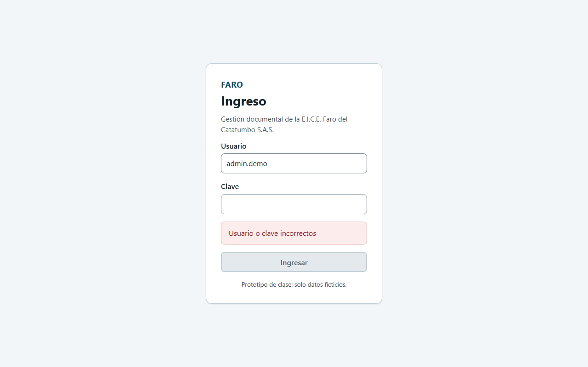

  *Captura 2. Clave incorrecta. [CONFIRMADO]*

- «**Demasiados intentos de ingreso. Intenta de nuevo en 15 minutos.**»: tras **5 intentos fallidos con el mismo usuario** o **30 desde el mismo lugar** en 15 minutos, el sistema bloquea el ingreso durante ese tiempo (ADR-0009). Espera y vuelve a intentar.

  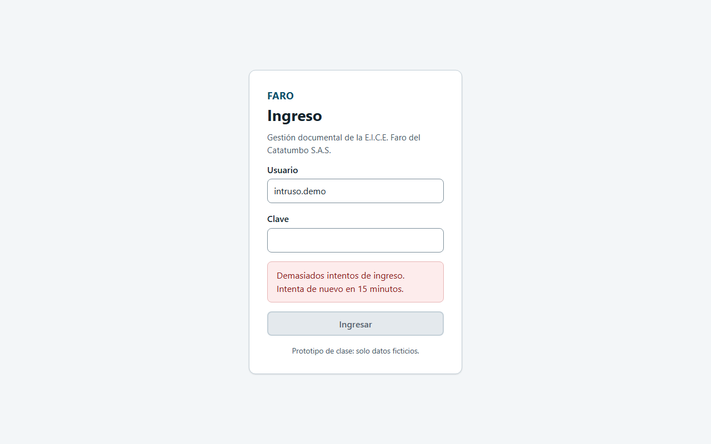

  *Captura 3. Bloqueo temporal. [CONFIRMADO]*

- «**Tu sesión terminó. Ingresa de nuevo para continuar.**»: aparece si tu sesión venció. Una sesión vence a las **8 horas sin usarla** y, aunque la uses sin parar, a los **7 días** (ADR-0003). Al ingresar, el sistema intenta llevarte a la pantalla a la que querías ir [POR VERIFICAR] en el caso de una sesión que vence a mitad de uso.

Para **salir**, pulsa **Cerrar sesión**, arriba a la derecha. Hazlo siempre que uses un computador compartido.

**Tu usuario lo crea el administrador** (ver la sección 10). Mientras se prueba el sistema existen tres usuarios de demostración: `admin.demo`, `editor.demo` y `consulta.demo`; su clave la define quien instala el sistema.

### Si te dieron una clave temporal

Cuando un administrador restablece tu clave, la clave que te da es **temporal** y tendrás que cambiarla (ADR-0011, PR #57, en revisión). Sobre la pantalla para hacerlo, ver la sección 11: [POR VERIFICAR: pantalla en el PR de la rama `feat/51-web-clave`, aún no existe].

## 3. Los tres roles: quién puede hacer qué

Tu **rol** lo ves arriba a la derecha, debajo de tu nombre. El menú de la parte superior cambia según el rol. Fuente: [`docs/matriz-de-roles.md`](matriz-de-roles.md), que una prueba comprueba contra la API real en cada cambio [CONFIRMADO].

| Puedes... | Consulta | Editor | Administrador |
|---|---|---|---|
| Buscar y ver documentos y su historial | Sí | Sí | Sí |
| Descargar el PDF de cualquier versión | Sí | Sí | Sí |
| Cargar un documento nuevo | No | Sí | Sí |
| Subir una versión nueva | No | Sí | Sí |
| Restaurar una versión anterior | No | Sí | Sí |
| Cambiar tu propia clave (PR #57, en revisión; sin pantalla todavía, sección 11) | Sí | Sí | Sí |
| Ver la auditoría | No | No | Sí |
| Crear usuarios, cambiar roles y desactivar (hoy por la API) | No | No | Sí |
| Restablecer la clave de otra persona (PR #57, en revisión; sin pantalla todavía, secciones 10 y 11) | No | No | Sí |

**Menú que ves:**

| Rol | Opciones del menú |
|---|---|
| Consulta | Documentos |
| Editor | Documentos, Cargar documento |
| Administrador | Documentos, Cargar documento, Usuarios, Auditoría |

*Captura 4. Rol de consulta: el menú solo tiene «Documentos». [CONFIRMADO]*

Si abres una pantalla que tu rol no admite, verás «**No tienes permiso para ver esta pantalla**. Tu rol no incluye esta función. Si la necesitas, pídesela a quien administra el sistema.»

**Algo que conviene saber [CONFIRMADO]:** hoy **todas las personas con sesión ven todos los documentos**. No hay permisos por expediente, por serie ni por área. Por eso no cargues nada reservado hasta que la entidad decida cómo manejarlo (`docs/matriz-de-roles.md`, sección 4).

## 4. Buscar y filtrar documentos

Al ingresar llegas a **Documentos**. Arriba hay dos controles: **Buscar** y **Serie**.

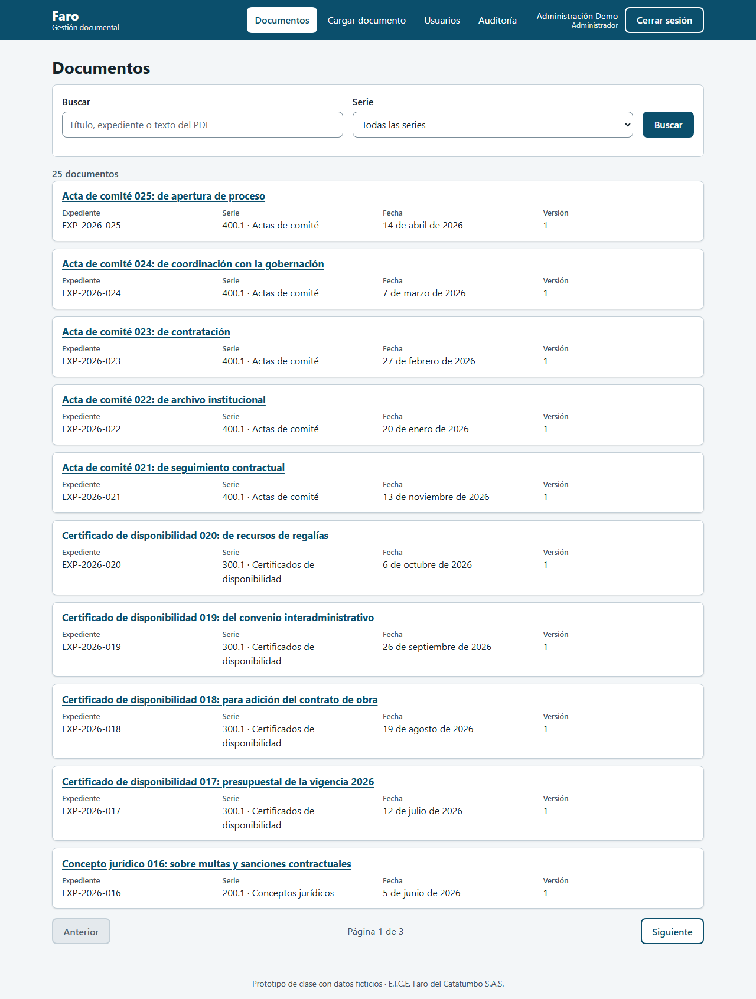

*Captura 5. Listado de documentos (rol de administrador). Abajo: «Página 1 de 3». [CONFIRMADO]*

**Buscar.** Escribe palabras del título, del expediente o del **texto del PDF** y pulsa **Buscar** (o Enter).

- No importan las **tildes ni las mayúsculas**: «interventoria» encuentra «Interventoría».
- Se encuentran **todas las palabras** que escribas (no basta con una). Más palabras, resultados más precisos.
- Singular y plural se tratan igual, y también las conjugaciones («interventorías», «pagos parciales»).
- Lo que escribas se toma como texto: las comillas, el `&` o el `|` no funcionan como operadores.
- Los resultados salen por **relevancia**: lo que coincide con el título pesa más que lo que coincide con el texto.
- El texto del PDF solo se busca en documentos con **capa de texto**. Si el PDF es una imagen, se encuentra por el título y el expediente, no por su contenido. El detalle de cada versión avisa cuando no la tiene (sección 5).
- Se indexan los primeros 300 000 caracteres de cada documento (unas 100 páginas) [POR VERIFICAR] con PDF reales (ADR-0007).

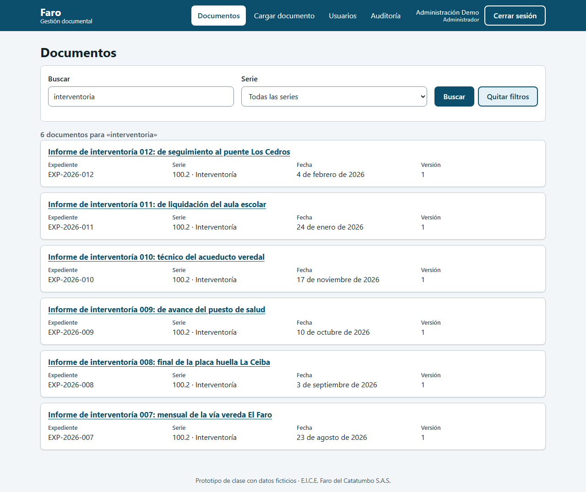

*Captura 6. Buscar «interventoria» da «6 documentos para «interventoria»». [CONFIRMADO]*

**Filtrar por serie.** El menú **Serie** muestra el cuadro de clasificación. Elige «Toda la serie 100» para ver todos los documentos de esa serie y sus subseries, o una subserie concreta (por ejemplo, «100.2 · Interventoría»). Puedes combinar la búsqueda con la serie.

*Captura 7. Filtro «Toda la serie 100»: 12 documentos. [CONFIRMADO]*

**Quitar los filtros.** Pulsa **Quitar filtros** para volver a ver todo.

**Pasar de página.** Se muestran 10 documentos por página: usa **Anterior** y **Siguiente**. Cuando no hay búsqueda, salen primero los cargados más recientemente; según se ve en la captura 5, no se ordenan por la fecha que figura en el documento.

**Compartir lo que ves.** La búsqueda, la serie y la página quedan en la dirección del navegador: puedes copiarla y mandársela a otra persona, o volver atrás sin perder lo que habías buscado.

**Si no aparece nada:** «Ningún documento coincide con lo que buscaste. Prueba con otras palabras o quita los filtros.» Si el sistema está vacío, dice «Aún no hay documentos cargados.» y, a quien puede cargar, le ofrece «Cargar el primer documento».

**En el celular.** La interfaz se adapta desde 360 px de ancho: el menú pasa a varias líneas y los datos de cada documento se acomodan en dos columnas.

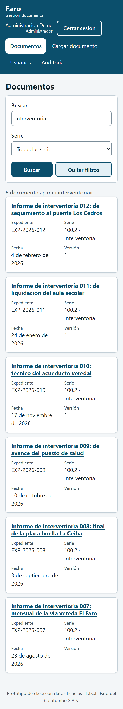

*Captura 8. La misma búsqueda en un celular (360 px). [CONFIRMADO]*

## 5. Ver un documento y su historial de versiones

En el listado, pulsa el título de un documento. Verás:

- **Datos del documento:** expediente, serie (con su nombre), fecha del documento, fecha y hora en que se cargó (hora de Colombia) y **versión vigente**.
- **Descargar la versión vigente (PDF)** y, si eres editor o administrador, **Subir una versión nueva**.
- **Historial de versiones**, la más reciente primero. Cada versión muestra:
  - su número, con la etiqueta **Vigente** si es la actual y **Restaura la versión n** si se creó restaurando otra;
  - el **motivo** del cambio;
  - **autor**, **fecha y hora**, **nombre del archivo**, **tamaño** y los primeros caracteres de la **huella SHA-256**;
  - el botón **Descargar** de esa versión;
  - si el PDF no tiene capa de texto: «Sin capa de texto: no se puede buscar por su contenido y solo se verifica por huella exacta.»

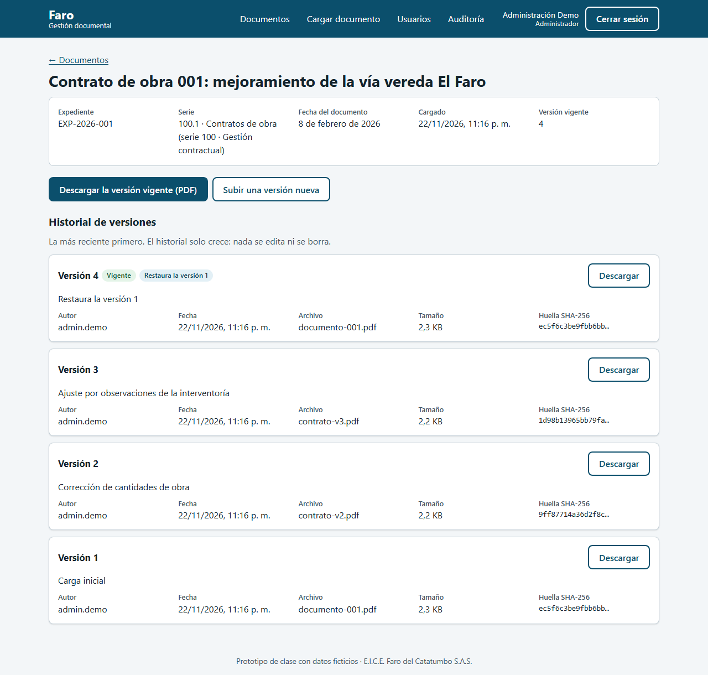

*Captura 9. Detalle de «Contrato de obra 001» con cuatro versiones; la 4 es la vigente y restaura la 1. Esta captura es del PR #54: todavía no muestra el botón «Restaurar», que llega con el PR #58 (se ve en las capturas 27 y 31, secciones 8 y 9). [CONFIRMADO]*

**Leer el historial.** «La más reciente primero. El historial solo crece: nada se edita ni se borra.» Si una versión se subió por error, no se borra: se corrige con una versión nueva o restaurando otra, y el error queda en el historial.

**Si el documento no existe** (una dirección mal escrita, por ejemplo), verás «El documento no existe» y un enlace para volver al listado.

*Captura 10. Documento que no existe. [CONFIRMADO]*

## 6. Descargar un documento

- **Versión vigente:** botón **Descargar la versión vigente (PDF)**, en la parte de arriba del detalle.
- **Cualquier versión:** botón **Descargar** en esa versión del historial.

Todos los roles pueden descargar. **Cada descarga queda registrada en la auditoría** con quién la hizo (README y `docs/matriz-de-roles.md`). Si tu sesión terminó con la página abierta y pulsas descargar, el navegador puede mostrarte un error en vez de llevarte al ingreso: vuelve a ingresar y repite [POR VERIFICAR] qué muestra cada navegador (ADR-0012, sección 4).

## 7. Cargar un documento nuevo

> **Estado:** pantalla del PR #58 (issue #24), *en revisión, todavía no fusionado en `main`*. Las capturas de esta sección y de las dos siguientes son de esa rama (commit `a6d6eb1`; las capturas 18 a 20, tomadas tras el arreglo de diseño `cac8cfe`), con datos ficticios [CONFIRMADO]. Lo que no tiene captura va marcado. Si el PR cambia en la revisión, los textos pueden cambiar.

**Quién:** editor y administrador. **Dónde:** menú **Cargar documento** (también el enlace «Cargar el primer documento» cuando el sistema no tiene ningún documento).

La pantalla «**Cargar un documento**» explica que, antes de guardar, el sistema revisa si ese mismo archivo, o uno muy parecido (por ejemplo, un reescaneo), ya existe. Pide:

*Captura 11. Formulario de carga, vacío (PR #58, 1280 px). [CONFIRMADO]*

| Campo | Qué escribir | Obligatorio |
|---|---|---|
| **Archivo PDF** | El PDF. Solo PDF, hasta **20 MB**. El servidor revisa que el contenido sea de verdad un PDF (no basta con cambiar la extensión). Al elegirlo, la pantalla muestra «Elegido: nombre · tamaño». | Sí |
| **Título** | El nombre con el que se buscará, por ejemplo «Acta de comité n.º 12». Hasta 200 caracteres (hay un contador). | Sí |
| **Expediente** | El código del expediente, por ejemplo `EXP-2026-014`. Hasta 60 caracteres. | Sí |
| **Subserie** | Dónde se clasifica en el cuadro de clasificación documental. Solo aparecen las subseries, agrupadas por serie. | Sí |
| **Fecha del documento** | La fecha que figura **en el documento**, no la de hoy. Formato AAAA-MM-DD. La interfaz no admite años anteriores a **1900** [PROPUESTA: tope del prototipo para evitar un año mal escrito como `0026`; si la entidad tiene documentos anteriores, se cambia, ADR-0012 sección 6.1]. | Sí |
| **Motivo de la carga** | Opcional. Si lo dejas vacío se guarda como «Carga inicial». Hasta 300 caracteres. | No |

Pulsa **Cargar documento**. Mientras sube, el botón dice «Subiendo el documento…», el formulario queda deshabilitado y no se puede enviar dos veces. Si todo está bien, te lleva al documento con un aviso verde.

*Captura 12. Carga correcta: «Documento «…» cargado: quedó como la versión 1.» [CONFIRMADO]*

**Cancelar** vuelve al listado.

### Si falta algo o algo está mal

Antes de enviar, el navegador revisa lo que puede. Cada campo con problema se marca en rojo con una frase que dice qué corregir, y el cursor va al primero.

*Captura 13. Se pulsó «Cargar documento» con todo vacío: «Elige el archivo PDF que quieres subir.», «Escribe el título del documento.», «Escribe el número o código del expediente.», «Elige la subserie donde se clasifica el documento.» e «Indica la fecha que figura en el documento.» [CONFIRMADO]*

- **PDF de más de 20 MB.** La pantalla avisa **antes de subir** y no gasta tiempo en enviarlo: «Pasa de 20 MB: este archivo pesa 21,0 MB. Reduce su tamaño o divídelo.» [CONFIRMADO]

  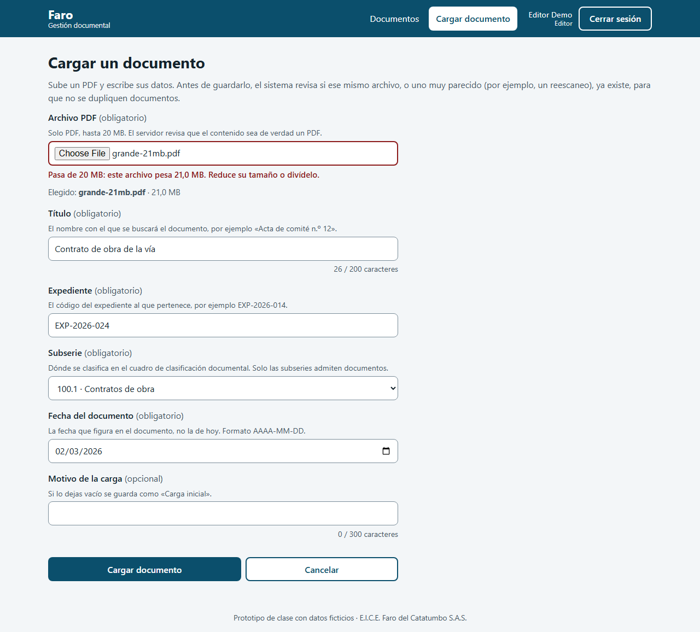

  *Captura 14. Archivo demasiado grande.*

- **Un archivo que se llama `.pdf` pero no es un PDF.** El navegador no lo puede notar; lo rechaza el servidor y la pantalla lo explica: «El archivo no es un PDF válido. Solo se aceptan archivos PDF: revisa que no sea otro tipo de archivo con la extensión cambiada, o vuelve a guardarlo como PDF.» [CONFIRMADO]

  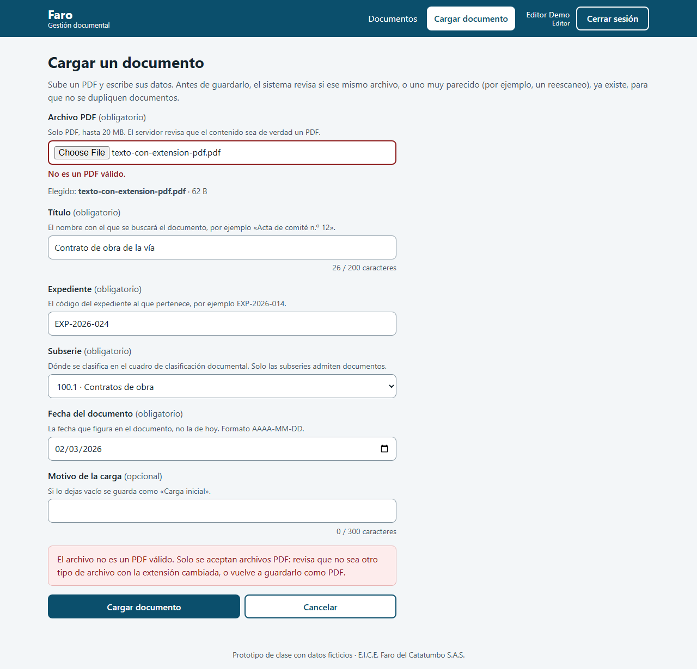

  *Captura 15. El servidor rechaza un archivo que no es un PDF.*

Otros mensajes que puedes encontrar **no tienen captura** en este borrador: salen del código de la interfaz de esa rama (`apps/web/src/api/errores.ts` y `apps/web/src/utilidades/validacion.ts`) [POR VERIFICAR: verlos en pantalla antes de la versión final].

| Si ves... | Qué pasó y qué hacer |
|---|---|
| «El archivo no es un PDF. Solo se aceptan archivos PDF (extensión .pdf).» / «El archivo está vacío. Elige otro.» | El archivo no es PDF o no tiene contenido. Guárdalo como PDF. |
| «El archivo pesa más de 20 MB, que es el máximo. Vuelve a exportarlo con menos calidad de imagen o divídelo en partes.» | El servidor rechazó un archivo muy pesado. |
| «Máximo 200 caracteres: este tiene N.» (con el máximo de ese campo) | El texto es demasiado largo. Acórtalo. |
| «La serie elegida no admite documentos. Elige una subserie del cuadro de clasificación.» | Solo las subseries admiten documentos. |
| «Escribe la fecha como AAAA-MM-DD, por ejemplo 2026-03-15.» / «Esa fecha no existe en el calendario. Revisa el día y el mes.» / «Revisa el año: la fecha no puede ser anterior a 1900.» | La fecha está mal escrita o no existe. |
| «La subserie o el documento elegido ya no existe. Recarga la página para ver el cuadro de clasificación actualizado.» | Alguien cambió el cuadro mientras llenabas el formulario. |
| «No se pudo conectar con el servidor. Revisa tu conexión e intenta de nuevo. Si el archivo llegó a subirse, el sistema te avisará de que ya existe y no se duplicará.» | Sin conexión. Revisa la red y repite. |
| «Tu sesión terminó. Ingresa de nuevo para continuar.» | La sesión venció (sección 2). |
| «Tu usuario no tiene permiso para esta acción. Solo los administradores y los editores pueden cargar documentos y versiones.» | Tu rol es de consulta (ver el final de la sección 9). |
| «Hiciste demasiadas peticiones en poco tiempo. Intenta de nuevo en …» | Límite de peticiones (ADR-0009). Espera. |

### Si el sistema avisa de un duplicado

La **verificación es doble** (ADR-0006): primero compara la huella del archivo con todo lo que ya existe y, si el PDF tiene capa de texto, compara también el **parecido del texto**.

**a) El archivo es idéntico a uno que ya existe.** El sistema **no lo carga** y muestra, debajo del formulario, «**Este archivo ya está en el sistema**»: dice a qué versión de qué documento (título, expediente y subserie) es idéntico, ofrece un enlace para **abrir el documento que ya existe** y recuerda que, si lo que tienes es una corrección, la subas como **versión nueva** de ese documento (sección 8). Lo que escribiste en el formulario se conserva.

*Captura 16. Archivo idéntico (aviso de duplicado exacto). [CONFIRMADO]*

**b) El archivo se parece mucho a uno que existe (por ejemplo, un reescaneo).** Aparece la pantalla «**Este archivo se parece a un documento que ya existe**», con los dos lados:

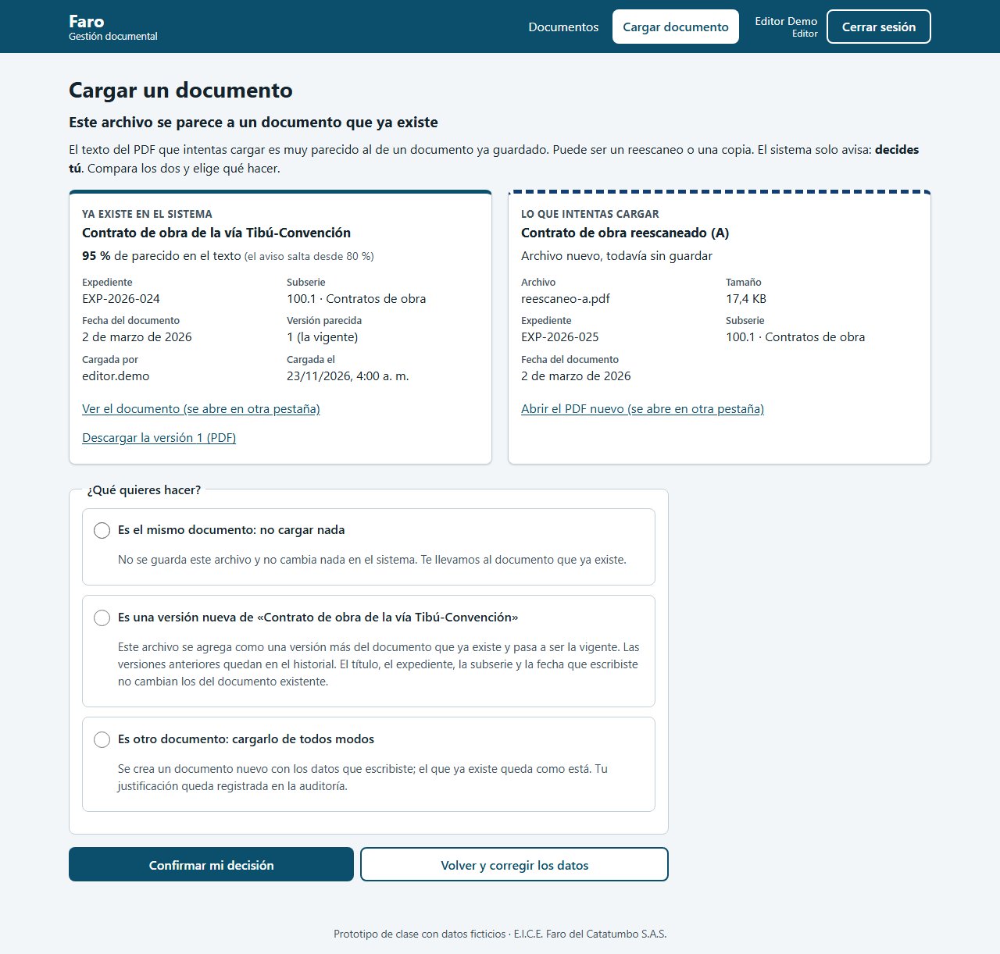

*Captura 17. Comparación de un duplicado probable. Los dos documentos son ficticios. [CONFIRMADO]*

- **Ya existe en el sistema:** título, el **porcentaje de parecido en el texto** («95 % de parecido en el texto (el aviso salta desde 80 %)»; el umbral de 80 % es provisional, ADR-0006), expediente, subserie, fecha del documento, versión parecida (por ejemplo «1 (la vigente)» o «1 (la vigente es la 2)»), quién la cargó y cuándo, y los enlaces «Ver el documento (se abre en otra pestaña)» y «Descargar la versión n (PDF)».
- **Lo que intentas cargar** (borde punteado: «Archivo nuevo, todavía sin guardar»): nombre y tamaño del archivo y los datos que escribiste, con el enlace «Abrir el PDF nuevo (se abre en otra pestaña)». En el celular, los dos lados se apilan.

[POR VERIFICAR] **El PDF no se muestra dentro de la página: se abre en otra pestaña.** La política de seguridad de la API no admite incrustarlo (ADR-0012, sección 6.1). Eso significa que no verás los dos documentos lado a lado en la misma pantalla, solo sus datos y el porcentaje; falta confirmar con personas de la entidad si eso basta para decidir (ADR-0012, sección 6.2). La pantalla tampoco muestra **qué texto cambió**, solo cuánto se parecen [PROPUESTA: un visor de diferencias queda fuera del alcance del prototipo].

**Si hay varios documentos parecidos**, el texto de arriba dice cuántos son («…muy parecido al de 2 documentos ya guardados») y, antes de los dos lados, aparece el grupo «**Elige con cuál quieres comparar**». Cada candidato es una **tarjeta propia, una por línea**, con un botón de opción, el título completo entre comillas, el expediente y el porcentaje de parecido (por ejemplo «…· expediente EXP-2026-031 · 95 % de parecido»). Un título largo ocupa dos o más renglones, pero se lee entero. Viene elegido el primero de la lista; al elegir otro cambia el lado «Ya existe en el sistema» (sus datos, su porcentaje y sus enlaces) y la opción «Es una versión nueva de «…»» pasa a nombrar ese documento. El lado «Lo que intentas cargar» no cambia.

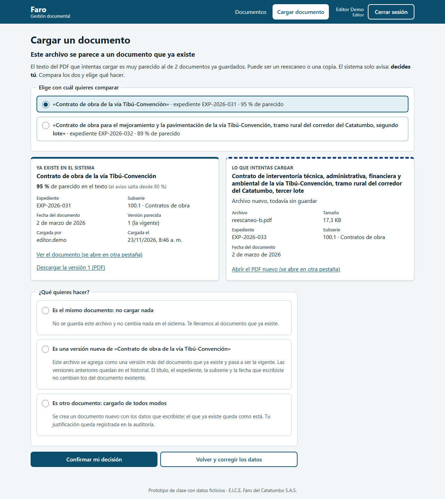

*Captura 18. Dos documentos parecidos: la lista de candidatos, cada uno en su tarjeta. [CONFIRMADO]*

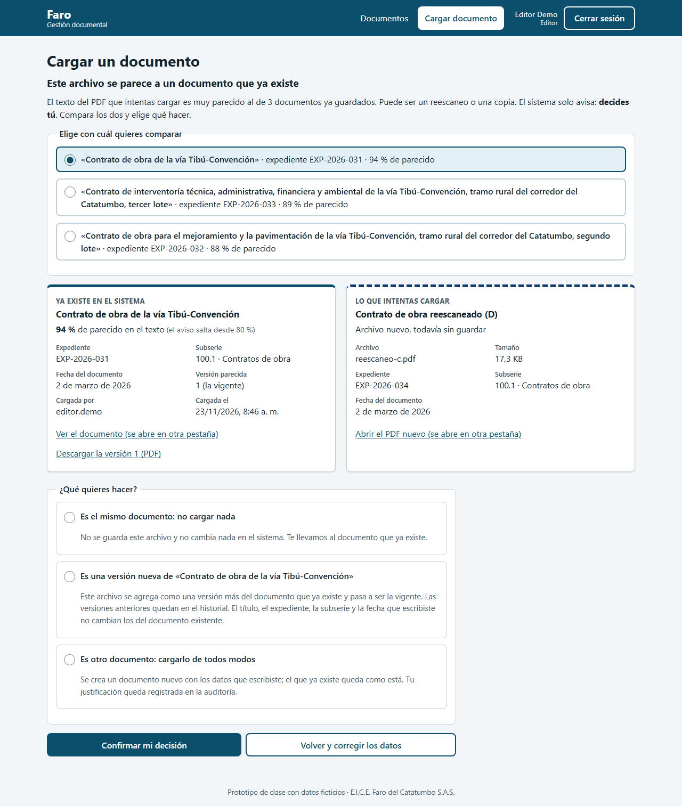

*Captura 19. Tres documentos parecidos. [CONFIRMADO]*

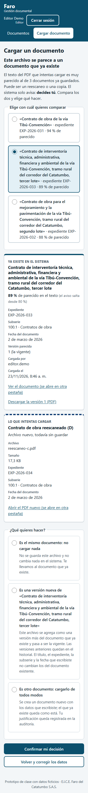

*Captura 20. Tres candidatos en el celular (360 px), con el segundo elegido: la tarjeta «Ya existe en el sistema» muestra ese documento. [CONFIRMADO]*

Estas tres capturas se tomaron **después de un arreglo de diseño** del PR #58 (commit `cac8cfe`): antes las tarjetas de la lista se veían encimadas unas sobre otras.

El sistema **solo avisa: decides tú**. Hay tres opciones, y cada una explica en la pantalla qué va a pasar:

| Opción | Qué pasa | Qué te pide |
|---|---|---|
| **Es el mismo documento: no cargar nada** | No se guarda el archivo y no cambia nada: la pantalla no llama a la API. Te lleva al documento que ya existe con el aviso «No se cargó nada: el archivo ya estaba en el sistema como «…».» | Nada. Botón: «No cargar el archivo». |
| **Es una versión nueva de «…»** | Tu archivo se agrega como una versión más del documento que ya existe y pasa a ser la vigente. Las versiones anteriores quedan en el historial. El título, el expediente, la subserie y la fecha que escribiste **no** cambian los del documento existente. | El **motivo** de la versión nueva (obligatorio, hasta 300 caracteres), por ejemplo «Reescaneo con mejor calidad». Botón: «Agregar como versión nueva». |
| **Es otro documento: cargarlo de todos modos** | Se crea un documento nuevo con los datos que escribiste; el que ya existe queda como está. Tu justificación queda registrada en la auditoría. | Una **justificación** (obligatoria, hasta 500 caracteres), por ejemplo «Es el contrato del segundo lote: usa la misma plantilla». Botón: «Cargar como documento nuevo». |

Si pulsas el botón sin elegir, la pantalla dice «Elige qué quieres hacer con este archivo.» Si eliges la segunda o la tercera y dejas vacío el texto, dice «Escribe el motivo: explica qué cambió respecto a la versión que ya existe.» o «Escribe la justificación: explica por qué no es un duplicado.» **Volver y corregir los datos** te devuelve al formulario sin perder lo escrito ni el archivo elegido.

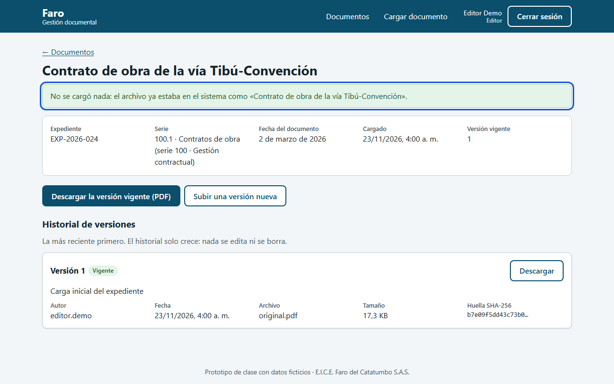

*Captura 21. Resultado de «Es el mismo documento»: no se guardó nada. [CONFIRMADO]*

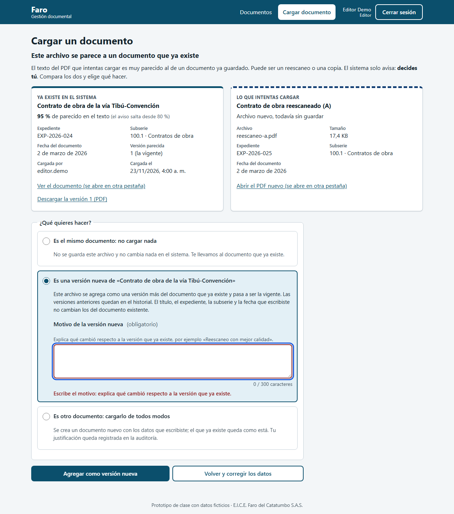

*Captura 22. «Es una versión nueva»: el motivo es obligatorio. [CONFIRMADO]*

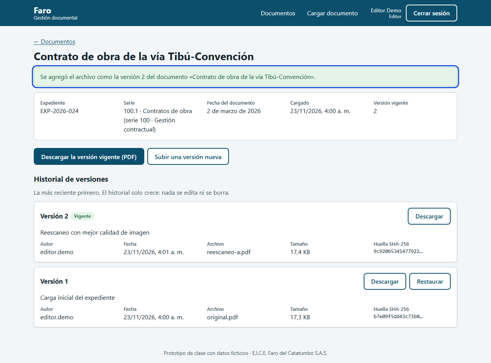

*Captura 23. Resultado de «Es una versión nueva»: el archivo quedó como la versión 2. [CONFIRMADO]*

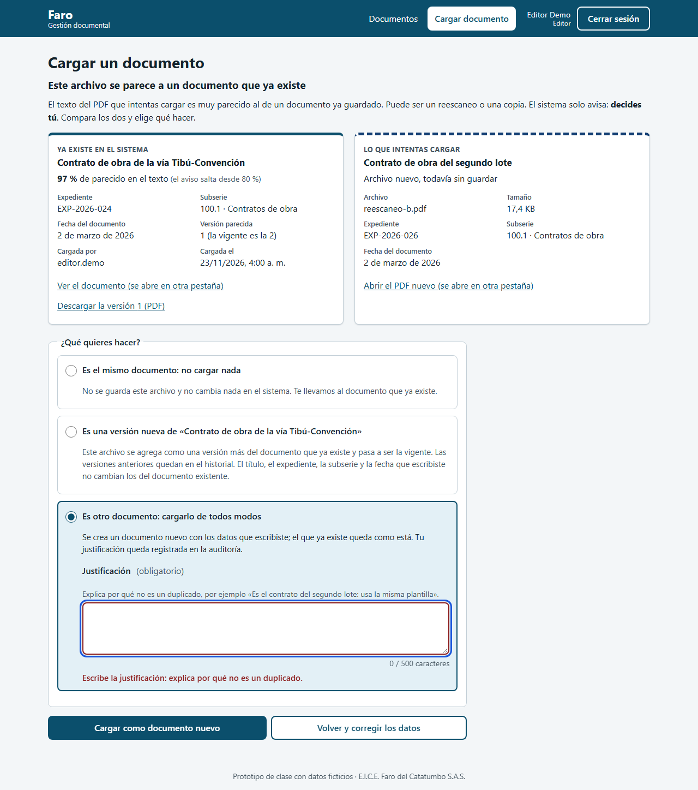

*Captura 24. «Es otro documento»: la justificación es obligatoria. [CONFIRMADO]*

El resultado de «Es otro documento» es un documento nuevo, con el mismo aspecto que la captura 12 y con el título y el expediente que escribiste. No tiene captura propia en este borrador.

**Cómo decidir** [PROPUESTA, no es una regla del sistema]:

- Si es **el mismo papel escaneado otra vez**, normalmente conviene **no cargar nada** (primera opción) o, si el escaneo nuevo es mejor, **agregarlo como versión nueva**.
- Si es una **actualización o corrección** del mismo documento, **versión nueva**.
- Si es **otro documento que usa la misma plantilla** (actas, contratos y oficios se parecen mucho entre sí), **otro documento**, y escribe bien la justificación.
- Si no estás seguro, abre los dos PDF en otra pestaña y compáralos antes de decidir.

**Tu decisión queda en la auditoría** (acción `decision_duplicado`), con tu justificación o tu motivo. Un PDF sin capa de texto, o con menos de 50 palabras, no se compara por parecido: solo se verifica por huella exacta.

**En el celular.** El formulario se adapta desde 360 px de ancho: los campos ocupan todo el ancho de la pantalla y se leen uno debajo del otro.

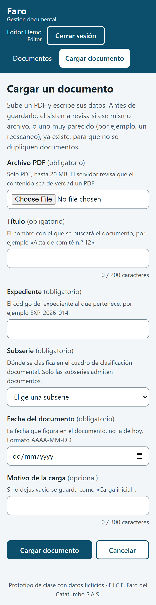

*Captura 25. Formulario de carga en celular (360 px). [CONFIRMADO]*

## 8. Subir una versión nueva

**Quién:** editor y administrador. **Dónde:** en el detalle de un documento, botón **Subir una versión nueva** (también se llega a una versión nueva desde la comparación de un duplicado, sección 7). Estado: PR #58 (issue #24), *en revisión*.

La pantalla muestra el enlace «← título del documento» para volver y recuerda el documento, su expediente y su versión vigente, y avisa: «No se borra nada: la versión actual queda en el historial y la que subas pasa a ser la vigente.» Pide:

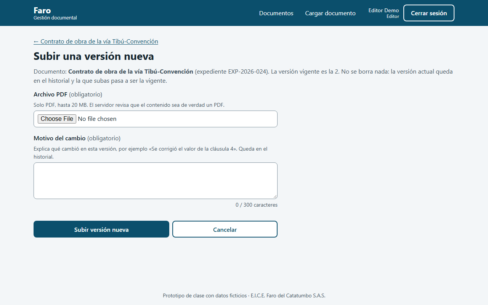

*Captura 26. Formulario de versión nueva. [CONFIRMADO]*

- **Archivo PDF** (obligatorio, hasta 20 MB; las mismas reglas que en la carga).
- **Motivo del cambio** (obligatorio, hasta 300 caracteres, con contador): explica qué cambió, por ejemplo «Se corrigió el valor de la cláusula 4». Queda en el historial y es lo que le explica el cambio a un auditor.

Si dejas algo vacío, la pantalla dice «Elige el archivo PDF que quieres subir.» o «Escribe el motivo: explica qué cambió en esta versión.» (misma forma que la captura 13).

Pulsa **Subir versión nueva** (mientras sube dice «Subiendo la versión…»). Te lleva al detalle con el aviso «Se agregó la versión n de «…». Las versiones anteriores siguen en el historial.» y la versión nueva arriba, como vigente.

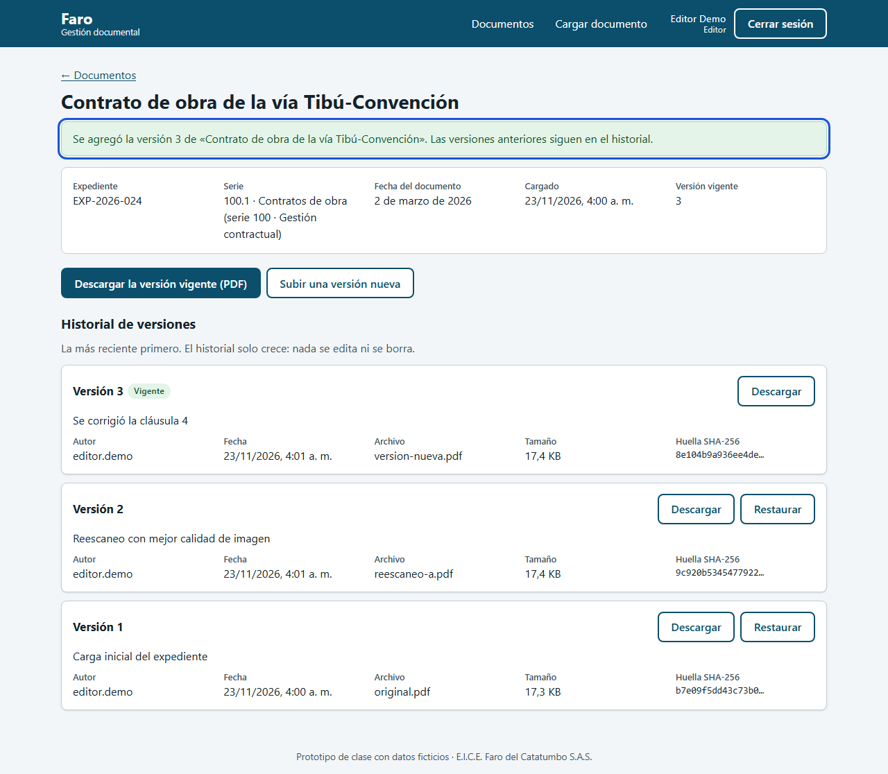

*Captura 27. Resultado de subir una versión nueva: la versión 3 es la vigente. [CONFIRMADO]*

**Si el archivo ya está en una versión de ese documento**, el sistema lo rechaza y no crea nada: «Este archivo tiene el mismo contenido que la versión n del documento, así que no se creó ninguna versión nueva. Si hiciste cambios, guarda el archivo corregido y súbelo de nuevo.» (ADR-0005).

*Captura 28. Se intentó subir el mismo contenido que la versión vigente. [CONFIRMADO]*

Si dos personas suben una versión del mismo documento a la vez, cada una recibe un número distinto y consecutivo; no se pierde ninguna (ADR-0005).

*Captura 29. Versión nueva en celular (360 px). [CONFIRMADO]*

## 9. Restaurar una versión anterior

**Quién:** editor y administrador. **Dónde:** en el historial del detalle, botón **Restaurar** de cada versión que no sea la vigente. Estado: PR #58 (issue #24), *en revisión*.

Restaurar **no borra ni edita nada**. Al pulsar **Restaurar** se abre, bajo esa versión, un panel «**¿Restaurar la versión n?**» que lo explica: «Se creará una **versión nueva** (la siguiente) con el mismo contenido que la versión n, y pasará a ser la vigente. **No se borra nada**: las versiones que ya existen, incluida la vigente, siguen en el historial.» Puedes escribir un **motivo** (opcional, hasta 300 caracteres; si lo dejas vacío se guarda como «Restaura la versión n»). Confirma con **Sí, restaurar la versión n** (mientras trabaja dice «Restaurando…») o con **Cancelar**.

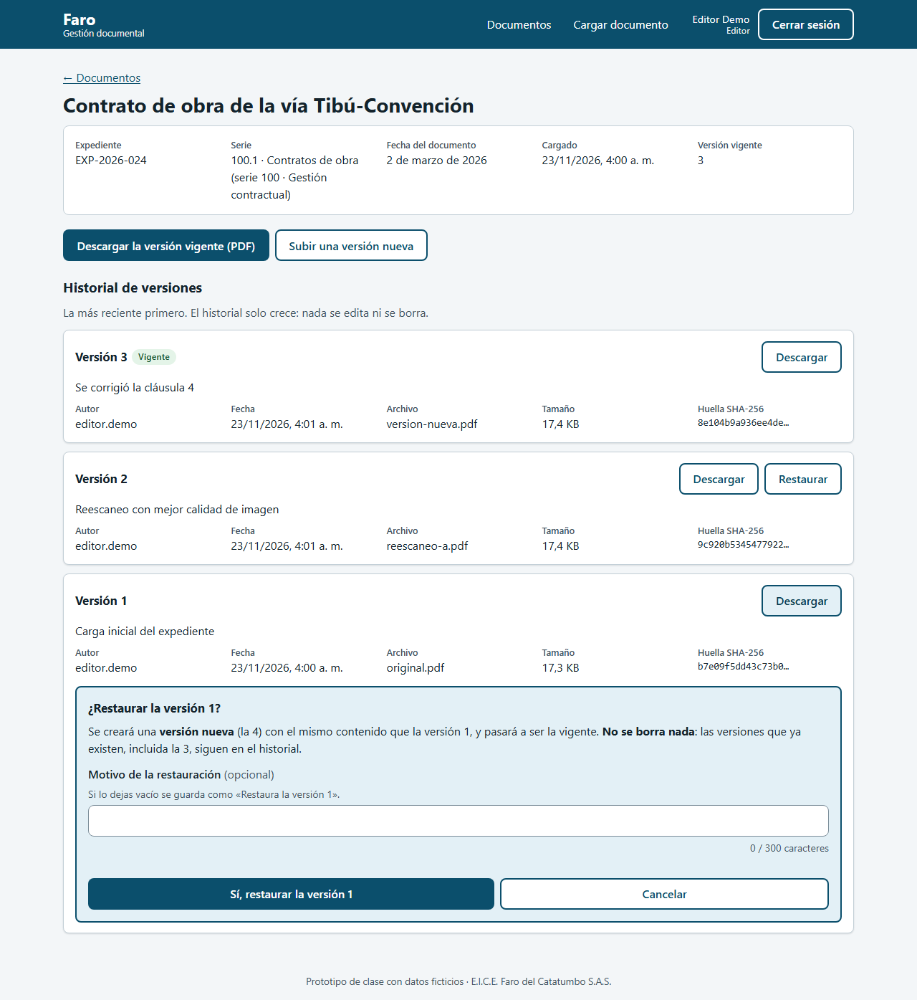

*Captura 30. Confirmación para restaurar la versión 1. [CONFIRMADO]*

Verás el aviso «Se creó la versión N con el contenido de la versión n. Las versiones anteriores siguen en el historial.» y la versión nueva aparece como vigente, con la etiqueta «Restaura la versión n».

*Captura 31. Resultado de restaurar: la versión 4 repite el contenido de la versión 1 y el historial conserva las anteriores. [CONFIRMADO]*

Si la versión vigente ya tiene ese mismo contenido, el sistema no crea nada y lo explica: «La versión vigente (n) ya tiene el mismo contenido que la versión que quieres restaurar, así que no se creó ninguna versión nueva.» (ADR-0005). Este mensaje no tiene captura en este borrador; sale del código de la interfaz [POR VERIFICAR: verlo en pantalla]. Se puede restaurar una restauración: el historial solo crece.

### Si tu rol es de consulta

El rol de consulta **no ve** los botones «Subir una versión nueva» ni «Restaurar», ni el enlace «Cargar documento» del menú. Si abre a mano la dirección de una pantalla de carga, ve el aviso de falta de permiso. La API también rechaza la acción con un 403, aunque alguien llegue por otro camino.

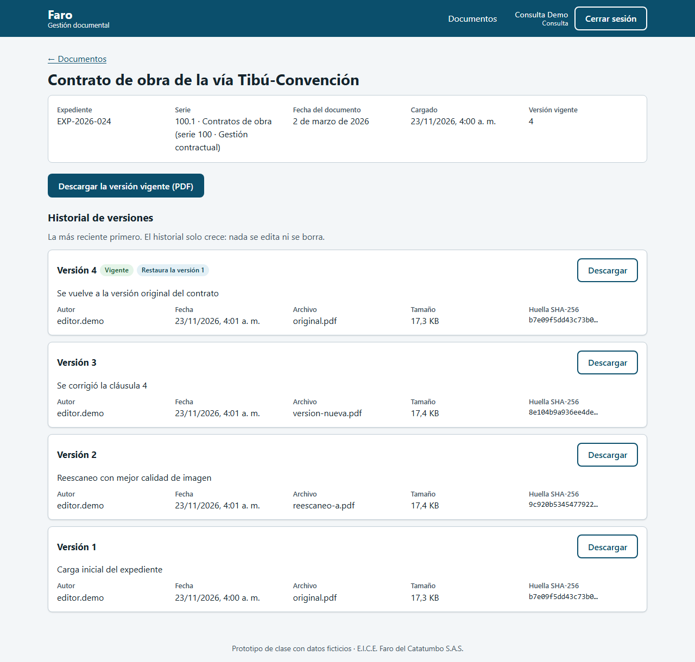

*Captura 32. El detalle visto como consulta: sin «Subir una versión nueva» ni «Restaurar». [CONFIRMADO]*

*Captura 33. Un usuario de consulta abre la pantalla de carga: «No tienes permiso para ver esta pantalla». [CONFIRMADO]*

## 10. Administración de usuarios y auditoría (administrador)

> **[POR VERIFICAR: sin captura]** Las pantallas **Usuarios** y **Auditoría** (issue #25) **no existen todavía**: hoy el menú del administrador muestra esas opciones, pero la pantalla es un aviso provisional que dice que se construye en el issue #25. Lo que sigue describe lo que el sistema **sí hace por la API** (README, ADR-0008 y ADR-0011); cuando exista la pantalla habrá que reescribir esta sección con sus textos.

### 10.1 Usuarios

El administrador puede:

- **Ver la lista de usuarios**, activos e inactivos.
- **Crear un usuario** con nombre de usuario, nombre, rol y clave inicial. El nombre de usuario va **en minúsculas** (3 a 64 caracteres: letras, números, punto, guion y guion bajo); «Ana» y «ana» no pueden ser dos cuentas. La clave tiene de **12 a 256 caracteres**. Entrégale la clave a la persona por un medio seguro, en persona o por llamada; no por un grupo de mensajes.
- **Cambiar el rol** de un usuario (administrador, editor o consulta). Rige desde la siguiente petición de esa persona, aunque tenga la sesión abierta.
- **Desactivar** o reactivar a un usuario. **Nunca se borra a nadie**, para no perder quién hizo qué. Al desactivar, sus sesiones se cierran al instante y no puede ingresar.
- **Restablecer la clave de otra persona** (clave temporal). Ver la sección 11.

**Reglas que el sistema impone:** el **último administrador activo no puede desactivarse ni dejar de ser administrador** («ultimo_administrador»); no se puede cambiar el nombre ni el nombre de usuario después de crear la cuenta; un administrador **no restablece su propia clave** (para eso existe el cambio de clave propio; PR #57, en revisión).

### 10.2 Auditoría

La auditoría es el **registro de lo que ocurre en el sistema**. **No se puede editar ni borrar**, ni por la API ni con comandos SQL normales (un disparador de la base lo impide; README y `docs/modelo-de-datos.md`). Solo el administrador la consulta, con filtros por **usuario, acción, documento y rango de fechas**, y paginada. Registra, entre otras cosas:

| Qué se registra | Cuándo |
|---|---|
| Ingreso, cierre de sesión | Al ingresar y al salir |
| Ingreso fallido (sin guardar lo que se escribió) y bloqueo por demasiados intentos | Al fallar o agotar el límite |
| Acceso denegado | Cuando alguien intenta algo que su rol no permite |
| Carga | Al cargar un documento |
| Versión y restauración | Al subir una versión nueva o restaurar una |
| Descarga | Al descargar una versión |
| Decisión ante un duplicado | Cuando alguien decide qué hacer ante el aviso (con su justificación o motivo) |
| Usuario creado, rol cambiado, usuario desactivado o reactivado | Al administrar usuarios |
| Clave cambiada y clave restablecida | Al cambiar o restablecer una clave (nunca se guarda la clave ni su huella) *(en revisión, PR #57)* |
| Cuadro de clasificación importado | Al importar el cuadro desde un CSV *(en revisión, PR #55)* |

## 11. Cambiar la clave

> **[POR VERIFICAR: pantalla en el PR de la rama `feat/51-web-clave`, aún no existe]**

## 12. Preguntas frecuentes

**¿Puedo borrar un documento o una versión?** No. El historial solo crece, por diseño: es lo que sirve de evidencia ante un ente de control. Si subiste algo por error, sube una versión nueva o restaura otra, y el error queda a la vista en el historial.

**El sistema no me deja subir un archivo porque «ya está en el sistema». ¿Por qué?** Porque es idéntico, byte por byte, a uno ya cargado. El mismo archivo no se carga dos veces. Abre el documento que ya existe; si tienes una corrección, súbela como versión nueva (sección 7, caso a).

**Subí un PDF escaneado y la búsqueda no lo encuentra por su contenido.** Probablemente el PDF no tiene capa de texto (es una imagen). Se encuentra por el título y el expediente. El detalle de la versión lo avisa con «Sin capa de texto…». El sistema no hace OCR por su cuenta (ADR-0006).

**¿Quién ve los documentos que subo?** Todas las personas con sesión, de cualquier rol. No hay permisos por documento.

**¿Mis acciones quedan registradas?** Sí: ingreso, cargas, versiones, restauraciones, descargas, decisiones ante duplicados y accesos denegados. Solo el administrador ve la auditoría.

**¿Por qué mi sesión se cerró?** Vence a las 8 horas sin usarla, o a los 7 días aunque la uses; también se cierra si un administrador te desactiva (o, con el PR #57, restablece tu clave).

**¿Qué pasa si dos personas suben una versión del mismo documento a la vez?** Cada una recibe un número distinto y consecutivo; no se pierde ninguna (ADR-0005).

**¿Se puede usar en el celular?** Sí, desde 360 px de ancho (capturas 8, 25 y 29). [POR VERIFICAR] con personas usuarias reales y con navegadores distintos de Chromium (ADR-0012).

**¿Qué es la «huella SHA-256» del historial?** Un código que identifica el contenido exacto del archivo. Si dos versiones tienen la misma huella, son el mismo archivo.

**¿Esto es el sistema definitivo de la entidad?** No. Es un prototipo de un proyecto de clase, con datos ficticios, y su cuadro de clasificación es provisional. No incluye las TRD y TVD definitivas ni la digitalización del archivo histórico (`CHANGELOG.md`, «Lo que NO incluye v2.0.0»).

## 13. Errores comunes

| Lo que ves | Qué significa | Qué hacer |
|---|---|---|
| «Usuario o clave incorrectos» | Usuario o clave mal escritos, o usuario desactivado | Revisa mayúsculas y espacios. Si sigue, pide ayuda al administrador |
| «Demasiados intentos de ingreso. Intenta de nuevo en 15 minutos.» | Superaste el límite de intentos | Espera el tiempo indicado |
| «Tu sesión terminó. Ingresa de nuevo para continuar.» | La sesión venció o te desactivaron | Ingresa de nuevo |
| «No tienes permiso para ver esta pantalla» | Tu rol no incluye esa función | Pídela a quien administra el sistema |
| «El documento no existe» | La dirección es incorrecta o el documento ya no está | Vuelve al listado |
| «Esta página no existe» | La dirección no es una pantalla de Faro | Usa el enlace «Ir a los documentos» |
| «No se pudo conectar con el servidor. Revisa tu conexión e intenta de nuevo.» | Sin internet, o el servidor está apagado | Revisa tu conexión y reintenta |
| «El servidor tuvo un problema. Intenta de nuevo en unos minutos.» | Falla del servidor | Reintenta; si persiste, avisa al administrador |
| Un botón de **Reintentar** en el listado o el detalle | Falló la carga de datos | Pulsa **Reintentar** |
| «Ningún documento coincide con lo que buscaste…» | La búsqueda o el filtro no tiene resultados | Prueba con otras palabras o pulsa **Quitar filtros** |
| Un error 403 de «cambio de clave requerido» (el texto exacto que muestra la pantalla es [POR VERIFICAR]) | Entraste con una clave temporal (PR #57, en revisión) | Ver la sección 11 [POR VERIFICAR: pantalla de cambio de clave pendiente] |

Los mensajes de la carga, la versión nueva y la restauración están en las secciones 7, 8 y 9. Los que no tienen captura salen del código de la interfaz y están marcados [POR VERIFICAR].

## 14. Pendientes de este borrador

Lo que falta antes de convertirlo en la versión final:

1. **Capturas que faltan:** usuarios y auditoría (issue #25, si se construye), cambio de clave (rama `feat/51-web-clave`), el mensaje de restaurar una versión que ya es la vigente (sección 9) y el resultado de «Es otro documento». Las de carga, duplicado (incluida la lista de varios candidatos, capturas 18 a 20, tomadas tras el arreglo `cac8cfe`), versión nueva y restaurar ya existen (capturas 11 a 33, datos ficticios). Todas se rehacen si el PR #58 cambia la interfaz en la revisión.
2. **Confirmar los textos** sin captura de las secciones 7 a 9 y todo lo de la sección 10 contra las pantallas reales. Los textos con captura se leyeron de la pantalla y del código de la rama del PR #58 (commits `a6d6eb1` y `cac8cfe`); el PR sigue en revisión y puede cambiar.
3. **La sección 11 (cambiar la clave)** queda vacía hasta que exista la pantalla en el PR de la rama `feat/51-web-clave`; entonces se escribe con sus textos y capturas.
4. **Quién redacta la versión final** [POR VERIFICAR]: César (parte académica) o Juan (parte técnica). Los dos revisan.
5. **Revisión con personas que usen el sistema** (ingeniería, jurídica, contabilidad, gerencia): este texto no se ha probado con nadie [SUPUESTO] que sea claro.
6. **Capturas descartadas:** la del aviso «Tu sesión terminó» se ve con el cuadro del aviso cortado y superpuesto sobre la tarjeta de ingreso; se dejó fuera hasta que se corrija o se confirme que es un defecto de la captura.

## 15. Fuentes

- Capturas: `docs/manual/capturas/` (datos ficticios; 1 a 10 de la interfaz del PR #54 y 11 a 33 de la del PR #58, a 1280 px y a 360 px).
- Código de la interfaz leído en las ramas `feat/23-web-listado` (PR #54) y `feat/24-web-carga` (PR #58).
- [`docs/matriz-de-roles.md`](matriz-de-roles.md) (roles), [ADR-0003](adr/0003-autenticacion-y-sesiones.md) (sesiones), [ADR-0005](adr/0005-versionado-y-restauracion.md) (versiones y restauración), [ADR-0006](adr/0006-verificacion-doble-de-duplicados.md) (duplicados), [ADR-0007](adr/0007-busqueda-por-texto-completo.md) (búsqueda), [ADR-0008](adr/0008-administracion-de-usuarios.md) (usuarios), [ADR-0009](adr/0009-seguridad-minima-para-exponer-la-api.md) (límite de intentos) y, en revisión, ADR-0011 (claves, PR #57) y ADR-0012 (interfaz, PR #54; la sección 6 de ese ADR, del PR #58, explica las decisiones de la carga).
- [`README.md`](../README.md) y [`CHANGELOG.md`](../CHANGELOG.md).
