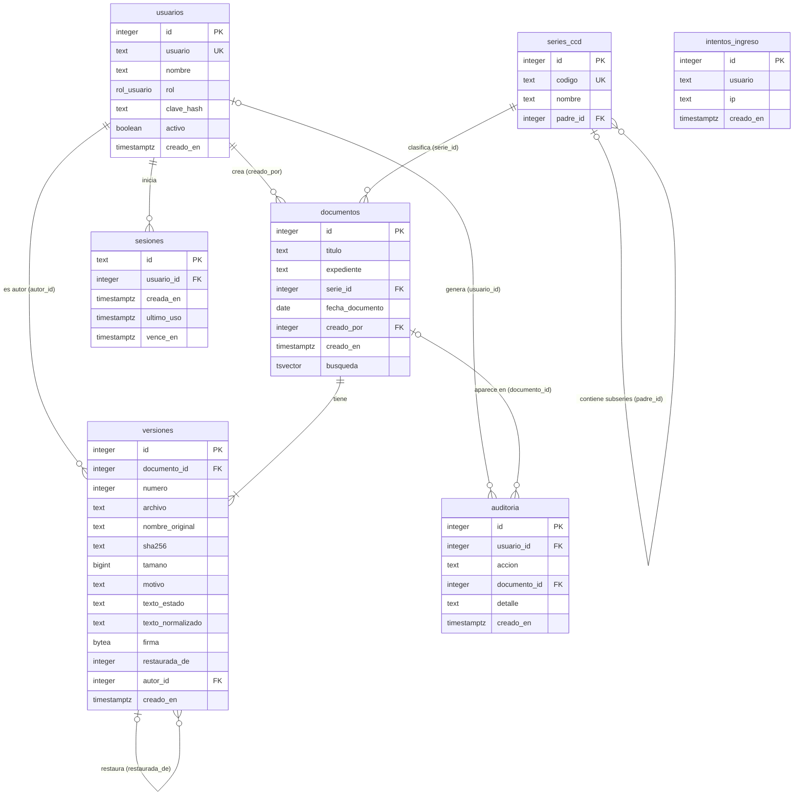

# Modelo de datos

- **Fecha:** 22 de noviembre de 2026
- **Issue:** #16
- **Alcance:** el esquema real de PostgreSQL del prototipo v2 (`apps/api`), tal como queda después de aplicar las migraciones `0000` a `0006`. No describe el prototipo v1 (SQLite).
- **Etiquetas de certeza:** [CONFIRMADO] comprobado contra la base por la prueba de la sección 1; [PROPUESTA] decidido pero aún no construido; [POR VERIFICAR] falta un dato.

## 1. Cómo se mantiene al día [CONFIRMADO]

Este documento no se actualiza solo, pero **no puede quedar desactualizado sin que el CI falle**: `apps/api/test/modelo-de-datos.e2e-spec.ts` lee las tablas de la sección 4 y las compara con `information_schema` y el catálogo de PostgreSQL de una base migrada de verdad. Comprueba, tabla por tabla:

- las columnas (nombre y tipo), y si admiten nulos, sin importar el orden (en la base, las columnas que agregaron las migraciones quedan al final; aquí se agrupan por sentido);
- la clave primaria, las claves foráneas de una columna y las restricciones únicas de una columna;
- que no sobre ni falte ninguna tabla;
- las restricciones `CHECK` y las de varias columnas (sección 5), los índices (sección 6), los disparadores (sección 7), los valores del tipo `rol_usuario` y los de `auditoria.accion` (sección 8).

Quien cambie el esquema (`apps/api/src/base-datos/esquema.ts`, con su migración) actualiza este documento en el mismo PR; si no, esa prueba lo avisa. **Lo que la prueba no comprueba son las descripciones y el diagrama de la sección 2:** esos se revisan a mano.

## 2. Diagrama entidad-relación

Cómo leerlo:

- **Un documento es la ficha** (título, expediente, serie, fecha) y **sus versiones son los archivos**. Un documento siempre tiene al menos una versión (la carga inicial es la versión 1) y la **vigente es la de número más alto**. La aplicación nunca edita ni borra una versión: restaurar una crea una nueva que apunta al mismo archivo (ADR-005). La base no lo impone con un disparador, a diferencia de `auditoria` (sección 7) [POR VERIFICAR si conviene agregarlo].
- **Los archivos no están en la base.** `versiones.archivo` es la clave de un objeto en el almacén de archivos (disco en local, S3 compatible en la nube; ADR-004). La clave depende del contenido (`documentos/<sha256>.pdf`), así que dos versiones con el mismo contenido (una restauración) comparten objeto.
- **El cuadro de clasificación tiene dos niveles** (`series_ccd`: serie y subserie) y los documentos cuelgan solo de subseries. Es **provisional**: no son las TRD/TVD definitivas, que corresponden al Comité de Archivo y están fuera del alcance del proyecto.
- **`auditoria` no tiene clave foránea obligatoria a nada:** un evento como un ingreso fallido de un usuario inexistente no tiene usuario ni documento.

## 3. Tipos enumerados

| Tipo | Valores | Dónde se usa |
|---|---|---|
| `rol_usuario` | `administrador`, `editor`, `consulta` | `usuarios.rol` |

## 4. Diccionario de datos

En la columna **Clave**: `PK` clave primaria; `único` restricción única de esa sola columna; `FK tabla.campo` clave foránea de esa columna; `FK compuesta` forma parte de una clave foránea de varias columnas (sección 5); `—` ninguna. En **Nulo**, «Sí» si la columna admite nulos. Los identificadores son enteros que genera la base (`GENERATED ALWAYS AS IDENTITY`), nunca se escriben a mano.

### `usuarios`

Quienes pueden ingresar. Se desactivan, no se borran, para conservar la autoría de lo que hicieron.

| Campo | Tipo | Nulo | Clave | Descripción |
|---|---|---|---|---|
| `id` | integer | No | PK | Identificador. |
| `usuario` | text | No | único | Nombre de ingreso. |
| `nombre` | text | No | — | Nombre para mostrar. |
| `rol` | rol_usuario | No | — | `administrador`, `editor` o `consulta` (ADR-003). |
| `clave_hash` | text | No | — | Hash argon2id de la clave. Nunca sale por la API ni se escribe en la auditoría. |
| `activo` | boolean | No | — | Por defecto `true`. Un usuario inactivo no ingresa y sus sesiones se cierran al desactivarlo (ADR-008). Nunca se borra a nadie. |
| `creado_en` | timestamptz | No | — | Por defecto `now()`. |

### `series_ccd`

Cuadro de clasificación documental provisional: series y subseries.

| Campo | Tipo | Nulo | Clave | Descripción |
|---|---|---|---|---|
| `id` | integer | No | PK | Identificador. |
| `codigo` | text | No | único | Código de la serie o subserie (por ejemplo `100` y `100.1`). |
| `nombre` | text | No | — | Nombre. |
| `padre_id` | integer | Sí | FK series_ccd.id | Vacío en una serie; en una subserie, la serie de la que cuelga. |

### `documentos`

La ficha de cada documento. El archivo y su historial están en `versiones`.

| Campo | Tipo | Nulo | Clave | Descripción |
|---|---|---|---|---|
| `id` | integer | No | PK | Identificador. |
| `titulo` | text | No | — | Título. |
| `expediente` | text | No | — | Expediente al que pertenece, como lo identifica la entidad (texto libre por ahora). |
| `serie_id` | integer | No | FK series_ccd.id | Subserie en la que se clasifica. Un disparador exige que sea una subserie, no una serie (sección 7). |
| `fecha_documento` | date | No | — | Fecha del documento, no la de carga. |
| `creado_por` | integer | No | FK usuarios.id | Quién lo cargó. |
| `creado_en` | timestamptz | No | — | Cuándo se cargó. Por defecto `now()`. |
| `busqueda` | tsvector | Sí | — | Índice de búsqueda por texto completo: título (peso A), expediente (B) y texto de la versión vigente (C), normalizados y con la configuración `spanish`. Lo mantiene el servicio dentro de la transacción que cambia el documento (ADR-007). |

### `versiones`

Cada archivo de un documento. La aplicación solo agrega filas (la base no impide editarlas o borrarlas; ver sección 2).

| Campo | Tipo | Nulo | Clave | Descripción |
|---|---|---|---|---|
| `id` | integer | No | PK | Identificador. |
| `documento_id` | integer | No | FK documentos.id | Documento al que pertenece. |
| `numero` | integer | No | — | Número de versión dentro del documento: 1, 2, 3… Único por documento. La vigente es la más alta. |
| `archivo` | text | No | — | Clave del objeto en el almacén (`documentos/<sha256>.pdf`). |
| `nombre_original` | text | No | — | Nombre del archivo como lo subió quien lo cargó (limpio de rutas y caracteres de control). |
| `sha256` | text | No | — | Huella SHA-256 del contenido, en hexadecimal. Detecta el archivo idéntico. |
| `tamano` | bigint | No | — | Tamaño en bytes. |
| `motivo` | text | No | — | Por qué existe esta versión («Carga inicial», «Corrige el valor», «Restaura la versión 1»…). |
| `texto_estado` | text | No | — | `ok` si se extrajo la capa de texto del PDF; `sin_texto` si no hay texto suficiente (escaneado sin OCR, dañado, casi vacío). Por defecto `sin_texto`; las filas anteriores a la migración 0005 quedaron así. |
| `texto_normalizado` | text | Sí | — | Texto del PDF en minúsculas, sin tildes ni signos. Nulo si `texto_estado` es `sin_texto`. Alimenta la búsqueda y la comparación de duplicados. |
| `firma` | bytea | Sí | — | Firma de similitud (MinHash, 1 KB). Nula si `texto_estado` es `sin_texto` (ADR-006). |
| `restaurada_de` | integer | Sí | FK compuesta | Si esta versión restaura una anterior, el número de esa versión en el mismo documento. |
| `autor_id` | integer | No | FK usuarios.id | Quién la cargó o la restauró. |
| `creado_en` | timestamptz | No | — | Por defecto `now()`. |

### `auditoria`

Registro de lo que ocurre en el sistema. **Inmutable:** un disparador impide editar y borrar eventos (sección 7).

| Campo | Tipo | Nulo | Clave | Descripción |
|---|---|---|---|---|
| `id` | integer | No | PK | Identificador. |
| `usuario_id` | integer | Sí | FK usuarios.id | Quién lo hizo. Vacío cuando no se sabe (un ingreso con un usuario que no existe). |
| `accion` | text | No | — | Qué ocurrió. Los valores posibles están en la sección 8. |
| `documento_id` | integer | Sí | FK documentos.id | Documento afectado, si aplica. |
| `detalle` | text | Sí | — | Texto corto con lo necesario para entender el evento. Nunca claves, tokens ni el contenido de los documentos. |
| `creado_en` | timestamptz | No | — | Cuándo ocurrió. Por defecto `now()`. |

### `sesiones`

Sesiones de ingreso (ADR-003). Viven en la base, no en la memoria del proceso: sobreviven a un reinicio de la aplicación.

| Campo | Tipo | Nulo | Clave | Descripción |
|---|---|---|---|---|
| `id` | text | No | PK | SHA-256 (hexadecimal) del token de la cookie. El token nunca se guarda: quien lea la base no puede usar las sesiones. |
| `usuario_id` | integer | No | FK usuarios.id | Dueño de la sesión. |
| `creada_en` | timestamptz | No | — | Cuándo se creó. Por defecto `now()`. |
| `ultimo_uso` | timestamptz | No | — | Último uso. Por defecto `now()`. |
| `vence_en` | timestamptz | No | — | Vence por inactividad; se renueva al usarla. |

### `intentos_ingreso`

Intentos de ingreso recientes, para limitarlos por usuario y por IP (ADR-009). **No tiene claves foráneas a propósito:** se guarda lo que se escribió en el campo usuario, exista o no, para que un usuario inexistente se limite igual que uno real y la respuesta no delate cuáles existen. Es una tabla de trabajo, no un registro histórico (para eso está `auditoria`): un ingreso correcto borra los intentos del usuario y lo que tiene más de un día se borra en el siguiente ingreso correcto.

| Campo | Tipo | Nulo | Clave | Descripción |
|---|---|---|---|---|
| `id` | integer | No | PK | Identidad generada. |
| `usuario` | text | No | — | Lo escrito en el campo usuario, en minúsculas, sin espacios de los lados y truncado a 64 caracteres. |
| `ip` | text | No | — | La IP que ve la API, según `CONFIAR_EN_PROXY` (ADR-009), o `desconocida`. |
| `creado_en` | timestamptz | No | — | Cuándo se hizo el intento. Por defecto `now()`. La ventana de 15 minutos se mide con el reloj de PostgreSQL. |

## 5. Restricciones de varias columnas y `CHECK`

Las claves primarias y las foráneas y únicas de una sola columna están en el diccionario. Estas son las demás.

| Nombre | Tabla | Qué garantiza |
|---|---|---|
| `versiones_documento_numero_uq` | `versiones` | Única `(documento_id, numero)`: no hay dos versiones con el mismo número en un documento. |
| `versiones_restaurada_de_fk` | `versiones` | Clave foránea `(documento_id, restaurada_de)` → `versiones(documento_id, numero)`: la versión que se restaura existe y es del mismo documento. |
| `versiones_restaurada_anterior_ck` | `versiones` | `restaurada_de` es nulo o menor que `numero`: solo se restaura una versión anterior. |
| `versiones_texto_estado_ck` | `versiones` | `texto_estado` solo vale `ok` o `sin_texto`. |
| `versiones_texto_coherente_ck` | `versiones` | Con `texto_estado = 'ok'` hay texto y firma; con `sin_texto` no hay ninguno de los dos. |

## 6. Índices

Sin contar los de las claves primarias ni los de las restricciones únicas.

| Índice | Tabla | Columnas | Para qué |
|---|---|---|---|
| `documentos_serie_idx` | `documentos` | `serie_id` | Listar y filtrar por serie. |
| `documentos_expediente_idx` | `documentos` | `expediente` | Buscar los documentos de un expediente. |
| `documentos_busqueda_idx` | `documentos` | `busqueda` (GIN) | Búsqueda por texto completo (ADR-007). |
| `versiones_documento_sha256_uq` | `versiones` | `(documento_id, sha256)`, única, solo donde `restaurada_de` es nulo | Un documento no repite el contenido en dos versiones nuevas. Una restauración repite la huella a propósito y queda fuera (ADR-005). |
| `versiones_sha256_idx` | `versiones` | `sha256` | Avisar si otro documento ya tiene el mismo archivo. |
| `auditoria_creado_en_idx` | `auditoria` | `creado_en` | Listar la auditoría por fecha. |
| `sesiones_usuario_idx` | `sesiones` | `usuario_id` | Borrar o buscar las sesiones de un usuario. |
| `intentos_ingreso_usuario_idx` | `intentos_ingreso` | `(usuario, creado_en)` | Contar los intentos recientes de un usuario. |
| `intentos_ingreso_ip_idx` | `intentos_ingreso` | `(ip, creado_en)` | Contar los intentos recientes de una IP. |

## 7. Disparadores

Reglas que la base hace cumplir aunque falle el servicio.

| Disparador | Tabla | Cuándo | Qué hace |
|---|---|---|---|
| `auditoria_sin_cambios` | `auditoria` | Antes de `UPDATE` o `DELETE` | Rechaza el cambio: los eventos no se editan ni se borran. `TRUNCATE` no se bloquea (las pruebas vacían las tablas): en el despliegue, la cuenta que usa la API no debe tener ese permiso. |
| `series_ccd_reglas` | `series_ccd` | Antes de `INSERT` o de actualizar `padre_id` | El cuadro tiene dos niveles: una subserie cuelga de una serie y nunca de otra subserie; una serie con subseries no puede pasar a colgar de otra; una subserie con documentos no puede volver a ser serie. |
| `documentos_solo_en_subseries` | `documentos` | Antes de `INSERT` o de actualizar `serie_id` | Un documento solo se asocia a una subserie. |

## 8. Valores de `auditoria.accion`

El catálogo está en `apps/api/src/auditoria/acciones.ts`. La columna es `text`, no un enumerado, para poder agregar acciones con una migración vacía; por eso la prueba compara esta lista con el catálogo del código.

| Valor | Cuándo se registra |
|---|---|
| `ingreso` | Un usuario ingresa. |
| `ingreso_fallido` | Intento de ingreso con usuario inexistente, usuario inactivo o clave incorrecta. El detalle dice cuál (`usuario inexistente`, `usuario inactivo` o `clave incorrecta`), sin lo que se escribió. |
| `ingreso_bloqueado` | Un intento de ingreso fallido agota el límite de intentos del usuario o de la IP (ADR-009): el siguiente intento ya recibirá 429. Se registra **una sola vez**, en ese intento; los rechazados después no se auditan para que insistir no llene la tabla. El detalle dice qué límite se alcanzó (`usuario`, `ip` o `usuario e ip`). |
| `cierre_sesion` | Un usuario cierra sesión. |
| `acceso_denegado` | Alguien con sesión intenta algo que su rol no permite. |
| `carga` | Se carga un documento nuevo (versión 1). |
| `descarga` | Se descarga el archivo de una versión. |
| `version` | Se agrega una versión con contenido nuevo. |
| `restauracion` | Se restaura una versión anterior como versión nueva. |
| `decision_duplicado` | Quien carga decide ante un aviso de duplicado probable (nueva versión de un documento o documento distinto), con su justificación. |
| `usuario_creado` | Un administrador crea un usuario. El detalle dice quién es y su rol, nunca la clave. |
| `usuario_rol_cambiado` | Un administrador cambia el rol de un usuario. El detalle trae el rol anterior y el nuevo. |
| `usuario_desactivado` | Un administrador desactiva a un usuario; se cierran sus sesiones y el detalle dice cuántas. |
| `usuario_reactivado` | Un administrador reactiva a un usuario inactivo. |
| `ccd_importado` | Se importa el cuadro de clasificación desde un CSV con `npm run ccd:importar` (ADR-010). **Sin usuario** (`usuario_id` vacío): es un comando que corre con acceso a la base, no una petición con sesión. El detalle trae el nombre del archivo y su SHA-256, cuántas series se crearon, renombraron, movieron y eliminaron (con los códigos de las movidas y las eliminadas) y cuántas ausentes se conservaron. Solo se registra si hubo algún cambio: repetir el mismo archivo no deja evento. |

## 9. Historial de migraciones

Están en `apps/api/drizzle/`, se versionan en git y no se editan una vez fusionadas: un cambio de esquema es una migración nueva.

| Migración | Qué agrega |
|---|---|
| `0000_inicial` | `usuarios`, `series_ccd`, `documentos`, `versiones` y `auditoria` (el modelo del prototipo v1 adaptado a PostgreSQL). |
| `0001_sesiones` | `sesiones`. |
| `0002_auditoria_inmutable` | Disparador `auditoria_sin_cambios`. |
| `0003_ccd_reglas` | Disparadores `series_ccd_reglas` y `documentos_solo_en_subseries`. |
| `0004_versiones_restauracion` | `versiones.restaurada_de`, su clave foránea compuesta y `CHECK`, y la huella única por documento solo para versiones con contenido nuevo. |
| `0005_versiones_texto_y_firma` | `versiones.texto_estado`, `texto_normalizado` y `firma`, con sus `CHECK`. |
| `0006_busqueda_texto_completo` | `documentos.busqueda`, su índice GIN y el relleno de los documentos que ya existían. |
| `0007_intentos_ingreso` | `intentos_ingreso` y sus dos índices. |

## 10. Lo que el modelo todavía no tiene

- **Edición del título, el expediente y la fecha de un documento** [POR VERIFICAR]: hoy no hay forma de hacerlo. Quien la agregue debe recalcular `documentos.busqueda` en la misma transacción (ADR-007).
- **Expedientes como entidad propia** [POR VERIFICAR]: `documentos.expediente` es texto libre. Si la entidad necesita metadatos del expediente (contratista, valor, fechas), el cambio natural es una tabla `expedientes`; depende de lo que defina el Comité de Archivo y no se anticipa aquí.
- **Retención y disposición final (TRD/TVD)**: fuera del alcance del proyecto; el cuadro provisional está pensado para recibirlas después sin cambiar `documentos`.
